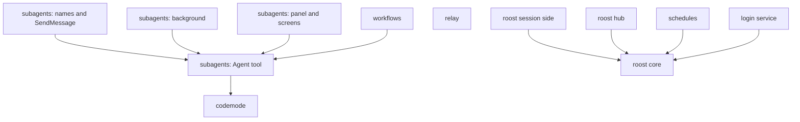

# Porting xpi features

xpi's features are built to be taken into another agent harness one at a time. This page is a menu, read like a kernel
configuration: pick the components you want, follow each one's dependencies, and port only that set. Every entry has
the same parts: what it gives the user, what it depends on, what to copy, what to rewrite, how to verify it, the
platform notes, and the detailed guide.

Two kinds of host are meant:

- **A pi-based agent** (a fork, a rebranded build, an app on pi's SDK): it has pi's extension API, rpc mode and TUI. The
  extension components (codemode, subagents, workflows, relay, the session side of roost) port as files plus a few
  renames.
- **Any other harness**: the roost core (daemon, PTY host, command line) imports nothing of xpi and talks to sessions
  over unix sockets and environment variables, so it ports to any agent that runs in a terminal. The extension
  components need the host capabilities their entries list.

Linux is the reference platform. Platform instructions are written for Linux; macOS differences follow them. Windows is
not supported by the components that need a PTY, unix sockets or a service manager.

Agent teams (messages between sessions, watches) will be added to this menu when they are built.

## Dependency overview

| Component | Requires (components) | Requires (host) | Minimal set to port |
|---|---|---|---|
| [codemode](#codemode) | none | tool registration, worker threads (Node or Bun), WebAssembly | codemode |
| [subagents: Agent tool](#subagents-agent-tool) | codemode (or a direct tool, see the entry) | child processes, an rpc mode, session files, extension events | codemode, Agent tool |
| [subagents: names and SendMessage](#subagents-names-and-sendmessage) | Agent tool | rpc `steer` | codemode, Agent tool, names |
| [subagents: background](#subagents-background) | Agent tool | codemode's script controller, detached nested calls, `sendMessage` that starts a turn | codemode, Agent tool, background |
| [subagents: panel and screens](#subagents-panel-and-screens) | Agent tool (background for script rows) | TUI widgets, raw terminal input, overlays | codemode, Agent tool, panel |
| [workflows](#workflows) | Agent tool (panel and background optional) | codemode add-ons, a tool context for commands | codemode, Agent tool, workflows |
| [relay](#relay) | none | virtual models, the `agent_before_settle` boundary with compaction drafts | relay |
| [roost core](#roost-core) | none | a PTY (node-pty), unix sockets, child processes, a CLI that starts a session from argv with a session file | roost core |
| [roost session side](#roost-session-side) | roost core | extension events and commands, CLI flags | roost core, session side |
| [roost hub](#roost-hub) | roost core (session side for xpi sessions' states) | a TUI library like `xpi-tui`, the host's launch builder | roost core, hub |
| [schedules](#schedules) | roost core (hub optional, for `/schedule`) | the host's launch builder (`scheduleLaunch`) | roost core, schedules |
| [login service](#login-service) | roost core (schedules make it useful) | a per-user service manager: systemd user units (Linux) or launchd (macOS) | roost core, login service |

Paths below are relative to the repository root; `coding-agent/` stands for `packages/xpi-coding-agent/`.

## codemode

- **Gives**: the `codemode` tool: the model writes a JavaScript script that calls the other tools; only the script's
  output enters the context. See [Codemode](codemode.md).
- **Depends on**: tool registration with a tool namespace (`ToolDefinition`, `ToolLoadout`), Node or Bun worker threads,
  the QuickJS WebAssembly file. Upstream pi has codemode; xpi adds the script controller (background) and add-ons
  (workflow helpers), both needed only by the components that use them.
- **Copy**: `packages/xpi-codemode/` (no pi dependency), `coding-agent/src/extensions/codemode/`.
- **Rewrite**: `getCodemodeWorkerSpecifier()` and `getQuickJSWasmPath()` (`coding-agent/src/config.ts`): where your
  build puts the worker and the wasm file. xpi also lists `codemode` in `DEFAULT_TOOL_NAMES`
  (`coding-agent/src/core/settings-manager.ts`); keep that if you want it on by default.
- **Verify**: `npm test` in `packages/xpi-codemode`; `test/suite/agent-session-codemode.test.ts`,
  `test/suite/codemode-scripts.test.ts` in coding-agent (run singly with vitest).
- **Linux**: nothing specific. **macOS**: the same.
- **Guide**: [`packages/xpi-codemode/README.md`](../../xpi-codemode/README.md); the core changes are in
  [xin-pi.md](../../../docs/xin-pi.md) ("codemode background controller", "workflows", "codemode is a default tool").

## subagents: Agent tool

- **Gives**: the `Agent` tool (Claude Code-compatible agent files, model selection, structured output, worktree
  isolation, agent memory, inline MCP servers, resume). See [Subagents](subagent.md).
- **Depends on**: codemode, because `Agent` is registered with `exposure: "codemode"`; with no codemode, change it to a
  direct tool. A child process per subagent, started as your agent's CLI in rpc mode with flags such as `--model`,
  `--tools`, `--system-prompt`, `--session-dir`; session files; extension events `session_start`,
  `session_shutdown`, `agent_start`, `agent_end`; `git` for worktree isolation (optional).
- **Copy**: `coding-agent/src/extensions/subagent/` (`agent-tool.ts`, `resolve.ts`, `runner.ts`, `invocation.ts`,
  `sessions.ts`, `registry.ts`, `definition.ts`, `discovery.ts`, `config.ts`, `worktree.ts`, `builtin/*.md`, and what
  they import).
- **Rewrite**: the child command (`subagent.piCommand`; unset, a child runs the same build as the parent:
  `invocation.ts`), flag names in `resolveChild` (`resolve.ts`), the model aliases (`subagent.models`), import paths
  (`xpi-*`).
- **Verify**: `npm run test:subagent` (offline); with your binary,
  `XPI_SUBAGENT_TEST_PI=<binary> npm run test:subagent:real` (Haiku).
- **Linux**: each child runs in its own process group (`process-tree.ts`), so stopping it or the parent's exit
  signals its whole tree; `git` on the PATH for worktrees. **macOS**: the same.
- **Guide**: [Porting the subagent extension](subagent-porting.md), layers 1 to 4.

## subagents: names and SendMessage

- **Gives**: `name` on an `Agent` call and the `SendMessage` tool: main talks to a named running subagent, or continues
  a finished one. See [Names and SendMessage](subagent.md#names-and-sendmessage).
- **Depends on**: the Agent tool; rpc `steer` in the child (for a running one) and resume (for a finished one).
- **Copy**: `send-message-tool.ts`, `talk.ts` (with the Agent tool's files).
- **Rewrite**: nothing beyond the Agent tool's.
- **Verify**: `test/subagent/faults/send-message.test.ts` (in `npm run test:subagent`),
  `test/subagent/real/19-names-and-messages.test.ts` (Haiku).
- **Linux / macOS**: nothing specific.
- **Guide**: [Porting the subagent extension](subagent-porting.md), "rpc protocol".

## subagents: background

- **Gives**: codemode scripts that move to the background (on the first `Agent` call, ctrl+b, or
  `run_in_background`) and report to main when they end; `run_in_background: true` agents. See
  [Background work](subagent.md#background-work).
- **Depends on**: the Agent tool; codemode's script controller `codemodeScripts` (`src/extensions/codemode/scripts.ts`);
  `ctx.detachNestedCalls()` / `releaseNestedCalls()` (`src/core/nested-tool-calls.ts`); `pi.sendMessage(..., {
  triggerTurn: true, deliverAs: "steer" })`; `session_shutdown` to stop what is left.
- **Copy**: `background.ts`, `runs.ts` (with the Agent tool's files); the codemode controller and the nested-call core
  change if your host lacks them.
- **Rewrite**: nothing; without the controller set `subagent.backgroundScripts: false`.
- **Verify**: `test/suite/codemode-scripts.test.ts`, `test/suite/codemode-background-nested.test.ts`,
  `test/suite/codemode-run-in-background.test.ts` (vitest, singly); `npm run test:subagent:parent` (Haiku).
- **Linux / macOS**: nothing specific.
- **Guide**: [Porting the subagent extension](subagent-porting.md), "4. Codemode".

## subagents: panel and screens

- **Gives**: the panel under the editor, the subagent screen, the script screen and `/subagents`. See
  [Watching and talking to subagents](subagent.md#watching-and-talking-to-subagents).
- **Depends on**: the Agent tool (background for script rows); `ctx.ui.setWidget`, `ctx.ui.onTerminalInput`,
  `ctx.ui.custom` overlays, pi's message components and `xpi-tui`.
- **Copy**: `panel.ts`, `subagent-screen.ts`, `script-screen.ts`, `subagents-command.ts`, `live.ts`, `color.ts`.
- **Rewrite**: the TUI calls, if your host's TUI differs; a web front end uses the registry instead (`list`,
  `subscribe`, `watch`, `stop`, `setModel`).
- **Verify**: `test/subagent/panel/` (in `npm run test:subagent`); `npm run test:subagent:tui` (Haiku, in a PTY).
- **Linux / macOS**: the terminal must pass 256-colour SGR escapes and kitty key releases are ignored.
- **Guide**: [Porting the subagent extension](subagent-porting.md), "5. TUI".

## workflows

- **Gives**: the script helpers (`agent`, `parallel`, `pipeline`, `phase`, `log`), the `Workflow` tool, saved
  workflows run as `/<name>` with no model turn, `/workflows`, and the built-in `/review`. See
  [Workflows](subagent.md#workflows).
- **Depends on**: the Agent tool; codemode add-ons (`codemodeAddons` in `src/extensions/codemode/addons.ts`: a prelude
  and host globals for every script that can call `Agent`); `ExtensionCommandContext.createToolContext()` so a command
  can start a script; a nested call with no assistant message (a fresh session) running against an empty one
  (`src/core/agent-session.ts`). The panel and background are optional (a saved workflow then runs in the foreground).
- **Copy**: `workflows.ts`, `workflow-run.ts`, `workflow-tool.ts`, `workflow-save.ts`, `workflows-command.ts`,
  `script-helpers.ts`, `builtin/workflows/` (with the Agent tool's files); the add-on registry and the core changes
  listed under "workflows" in [xin-pi.md](../../../docs/xin-pi.md).
- **Rewrite**: the workflow directories (`.pi/workflows`, `<agent dir>/workflows`; Claude Code's `.claude/workflows`
  are read too, in `workflows.ts`).
- **Verify**: `test/subagent/faults/workflows.test.ts`, `test/subagent/faults/script-helpers.test.ts` (in
  `npm run test:subagent`); `test/suite/subagent-workflow-tool.test.ts` (vitest).
- **Linux / macOS**: nothing specific.
- **Guide**: this entry and [Porting the subagent extension](subagent-porting.md) ("4. Codemode", "3. Extension API");
  there is no separate workflow porting guide.

## relay

- **Gives**: the virtual model `relay/auto`: a strong lead plans and reviews, a cheap worker builds, with `handover` and
  `handback` tools and `/handover`, `/handback`, `/relay`. See [Relay](relay.md).
- **Depends on**: no other component. Extension API only, no core change: `pi.registerVirtualModel` (a `route` that
  picks the physical model per request) and `getVirtualModelState`; `pi.on("agent_before_settle")` returning
  `{ entries, continue: true }` with a compaction draft (the hand-back record); `model_select`, `session_start`;
  `pi.setActiveTools` / `getActiveTools`; `pi.appendEntry`; `pi.sendMessage`; `ctx.modelRegistry.find`. It runs the
  acceptance commands through a shell and reads `git` for the diff the lead sees (optional: outside a repository, or
  in one without commits, there is no snapshot to diff against).
- **Copy**: `coding-agent/src/extensions/relay/` (six files; no import from other extensions).
- **Rewrite**: the provider and model ids (`relay`, `auto`), the settings namespace `relay.*` (`config.ts`).
- **Verify**: `test/suite/relay.test.ts` (vitest, offline); `npm run test:relay:real` (real models).
- **Linux**: the acceptance commands run with `shell: true` in their own process group, which is killed on timeout or
  abort. **macOS**: the same.
- **Guide**: this entry and [Relay](relay.md) (settings, the record, limits); there is no separate relay porting guide.

## roost core

- **Gives**: background sessions: a daemon per agent directory that runs sessions in PTYs held by host processes, and
  the `xpi roost` command line (`ls`, `attach`, `logs`, `log`, `reply`, `stop`, `rm`, `respawn`, `daemon ...`). See
  [Background Sessions](roost.md).
- **Depends on**: no other component, and nothing of the host agent: `packages/xpi-roost` imports no xpi package outside
  `src/hub/`. Host capabilities: node-pty, unix sockets, detached child processes, and a CLI that can start a session
  from an argv with a session file (`buildLaunch`, `lib/dispatch.ts`).
- **Copy**: `packages/xpi-roost/` (`src/lib`, `src/daemon`, `src/host`, `src/cli.ts`).
- **Rewrite**: the names that carry the host (state dir `<agent dir>/xpi-roost/`, runtime dir names, `ROOST_*`
  variables, the worker's argv and flags), listed in "What to copy and what to rewrite" of the roost guide; the caller
  of `runRoostCli` (agent directory, daemon and host entries, detach key).
- **Verify**: `npm run test:roost` in `packages/xpi-roost` (real daemons and PTYs, no model).
- **Linux**: node-pty has no Linux prebuild and compiles at install (python3, make, a C++ compiler); CI runs
  `npm rebuild node-pty` after an install that skipped scripts. Sockets go to `$XDG_RUNTIME_DIR/xpi-roost-<key>`
  (`/run/user/<uid>` under systemd-logind), else `/tmp/xpi-roost-<uid>/<key>`; socket paths are kept to 100 bytes.
  **macOS**: there is no `XDG_RUNTIME_DIR`, so sockets go under `/tmp`; node-pty ships a prebuild whose `spawn-helper`
  can lose its execute bit, which the host sets again (`fixSpawnHelper`, `src/host/main.ts`).
- **Guide**: [Porting roost](../../xpi-roost/docs/porting.md), steps 1 to 8.

## roost session side

- **Gives**: `xpi --bg "<task>"`, `/bg`, `/bg-fork`, `/agents`, the left arrow into the hub, the worker role that
  reports a session's state to the daemon, and the session write lock.
- **Depends on**: roost core. Extension events (`session_start`, `session_shutdown`, `agent_start`, `agent_settled`,
  `message_end`, `tool_execution_start`/`end`, `ui_prompt_start`/`end`, the compaction events, `model_select`,
  `thinking_level_select`), `pi.registerFlag` (`--bg`, `--bg-name`), `pi.registerCommand`, `pi.sendUserMessage`.
- **Copy**: `coding-agent/src/extensions/roost/`.
- **Rewrite**: the whole adapter is host code; keep its contracts (the job identity variables, the report ops, the
  session lock next to the session file).
- **Verify**: `test/roost-*.test.ts` in coding-agent, one file at a time with vitest.
- **Linux / macOS**: as roost core; on Windows the commands say background sessions are not supported.
- **Guide**: [Porting roost](../../xpi-roost/docs/porting.md), steps 2 to 5 and "What the host agent must have".

## roost hub

- **Gives**: the full-screen hub (`/agents`, `xpi roost hub`): every session, peek, reply, attach, start new ones,
  presets, the log.
- **Depends on**: roost core; the session side for xpi sessions' states (working, waiting) and slash commands in
  peek; a TUI library with what `xpi-tui` gives it, or a rewrite against `RoostPort` (`src/hub/roost-port.ts`).
  Everything about the host comes in `AgentViewOptions`: `connect`, `launch`, `launchShell`, the detach key, models,
  presets, resume, `builtins`, `scheduleLaunch`.
- **Copy**: `packages/xpi-roost/src/hub/`; the options builder `coding-agent/src/extensions/roost/hub-options.ts` as an
  example.
- **Rewrite**: `AgentViewOptions` for your host.
- **Verify**: `test/agent-view.test.ts` in xpi-roost; `test/roost-hub-pty.test.ts` and `test/roost-hub-options.test.ts`
  in coding-agent.
- **Linux / macOS**: as roost core.
- **Guide**: [Porting roost](../../xpi-roost/docs/porting.md), step 6.

## schedules

- **Gives**: `xpi roost schedule add|edit|list|run|pause|resume|rm` and the hub's `/schedule`: a task started as a new
  background session on a time rule, with catch-up, skips and retention of old runs.
- **Depends on**: roost core; the host's launch builder, given as `scheduleLaunch` to `runRoostCli` and the hub (the
  executable, the filtered environment, the stored trust decision, the model, the session directory with `{{run}}`).
  The hub is optional.
- **Copy**: `src/lib/schedule.ts`, `src/lib/schedules.ts`, `src/lib/clock.ts`, `src/hub/overlays/schedules.ts` (with
  roost core).
- **Rewrite**: `scheduleLaunch` in your adapter (xpi's is in `coding-agent/src/extensions/roost/cli.ts` and
  `hub-options.ts`).
- **Verify**: `test/schedule.test.ts`, `test/schedules.test.ts`, `test/schedules-overlay.test.ts` (in
  `npm run test:roost`).
- **Linux / macOS**: local time, including DST; nothing else.
- **Guide**: [Porting roost](../../xpi-roost/docs/porting.md#phase-2-schedules), "Phase 2: schedules".

## login service

- **Gives**: `xpi roost daemon install|uninstall`: the daemon starts at each login, so schedules run with no xpi open;
  `daemon status` says whether it is installed.
- **Depends on**: roost core; a per-user service manager. Useful with schedules.
- **Copy**: `src/lib/service.ts` (with roost core). The files are made by pure functions; the `launchctl` and
  `systemctl` calls are injected.
- **Rewrite**: the service names `xpi-roost-<key>.service` and `dev.xpi.roost.<key>` (`serviceName()`).
- **Verify**: `test/service.test.ts` (fakes, never the real service manager); then once by hand: `daemon install`,
  `daemon status`, `daemon uninstall`.
- **Linux**: a systemd user unit in `~/.config/systemd/user` (`Type=simple`, no `Restart=`, `KillMode=process`,
  `WantedBy=default.target`), enabled with `systemctl --user enable` and started only when no daemon runs. A user unit
  starts at login and stops when the last session ends; `loginctl enable-linger <user>` keeps it running without a
  login. The unit keeps the runtime directory of the terminal that installed it (`ROOST_RUNTIME_DIR`, else
  `$XDG_RUNTIME_DIR`); a shell without `XDG_RUNTIME_DIR` (some `su` or `ssh` sessions) looks under `/tmp` and is told
  `other_runtime_dir`. **macOS**: a launchd agent in `~/Library/LaunchAgents` (RunAtLoad, no KeepAlive,
  AbandonProcessGroup) loaded with `launchctl bootstrap gui/<uid>`; `launchctl bootout` stops the daemon it started,
  so uninstall starts it again outside the service.
- **Guide**: [Porting roost](../../xpi-roost/docs/porting.md#phase-2-schedules), "The login service".

## Adding a component

A new portable feature adds its entry here, in the same shape and with Linux first, and updates its detailed guide in
the same change (see `AGENTS.md`).
