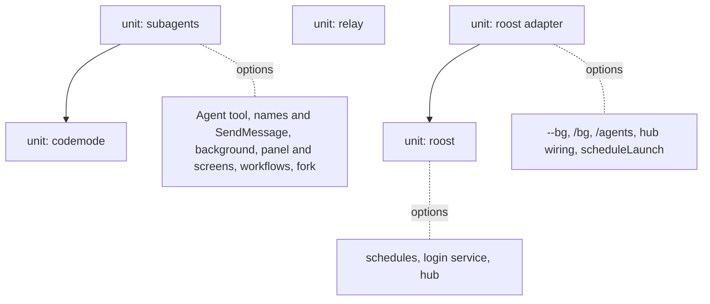

# Porting xpi features

This page is a menu for taking xpi's features into another agent harness, read like a kernel configuration: pick the
components you want, follow each one's dependencies, and port only that set. Two levels, as in a kernel:

- A **unit** is what you copy. Its files import each other, so a unit comes whole: you cannot copy half of it and build.
  There are five: [codemode](#codemode), [subagents](#subagents) (which needs codemode), [relay](#relay),
  [roost](#roost) (the `xpi-roost` package) and the [roost adapter](#roost-adapter) (which needs roost).
- An **option** is a feature inside a unit. It comes with the unit's files; you turn it off by a setting, or by removing
  the line that wires it in (named in each option), not by leaving files out.

Every entry has the same parts: what it gives the user, what it depends on, what to copy, what to rewrite, how to
verify it, the platform notes, and the detailed guide. The file lists come from the import graph of each unit's entry
file.

Two kinds of host are meant:

- **A pi-based agent** (a fork, a rebranded build, an app on pi's SDK): it has pi's extension API, rpc mode and TUI. The
  extension units (codemode, subagents, relay, the roost adapter) port as directories plus the core changes and renames
  their entries list; they also import the host's own `core/`, `modes/` and `config.ts` files, which a pi-based agent
  has.
- **Any other harness**: the roost core (daemon, PTY host, command line) imports nothing of xpi and talks to sessions
  over unix sockets and environment variables, so it ports to any agent that runs in a terminal. The extension
  components need the host capabilities their entries list.

Linux is the reference platform. Platform instructions are written for Linux; macOS differences follow them. Windows is
not supported by the components that need a PTY, unix sockets or a service manager.

Agent teams (a lead session and its named teammates, with messages and a shared task list inside one session)
will be added to this menu when they are built.

## Dependency overview

| Pick | Port these units | Host must have | Turn off what you do not want |
|---|---|---|---|
| [codemode](#codemode) | codemode | tool registration, worker threads (Node or Bun), WebAssembly | nothing to turn off |
| [Agent tool](#subagents-agent-tool) | codemode, subagents | rpc mode with xpi's flags, child processes, session files, the core changes listed under [subagents](#subagents) | the other subagent options, by settings or wiring lines |
| [names and SendMessage](#subagents-names-and-sendmessage), [background](#subagents-background), [panel and screens](#subagents-panel-and-screens), [workflows](#workflows) | codemode, subagents | as the Agent tool, plus what each option lists | the options you do not want |
| [relay](#relay) | relay | virtual models (`core/virtual-models.ts`), the `agent_before_settle` boundary with compaction drafts | nothing to turn off |
| [roost core](#roost-core) | roost | node-pty, unix sockets, detached child processes, a CLI that starts a session from argv with a session file | [schedules](#schedules) (no `scheduleLaunch`), [login service](#login-service) (remove its `cmdDaemon` branch); the hub is a separate entry point, unused unless wired |
| [roost session side](#roost-session-side), [hub](#roost-hub) | roost, roost adapter | extension events, flags and commands; a TUI library like `xpi-tui` for the hub | `/agents` and the hub, by removing their registrations |

A pick never needs a unit outside its row: the import graphs of `extensions/relay/index.ts`,
`extensions/codemode/index.ts`, `extensions/subagent/index.ts`, `extensions/roost/index.ts` and xpi-roost's three
process entries reach only the files listed in their units (plus the host's own `core/`, `modes/`, `utils/`,
`cli/args.ts` and `config.ts`, and, for subagents, the MCP built-in's `config.ts` named in its entry).

Paths below are relative to the repository root; `coding-agent/` stands for `packages/xpi-coding-agent/`.

## codemode

- **Gives**: the `codemode` tool: the model writes a JavaScript script that calls the other tools; only the script's
  output enters the context. See [Codemode](codemode.md).
- **Depends on**: tool registration with a tool namespace (`ToolDefinition`, `ToolLoadout`), Node or Bun worker threads,
  the QuickJS WebAssembly file. Upstream pi has codemode; xpi adds the script controller (`scripts.ts`) and add-ons
  (`addons.ts`), which the subagents unit imports.
- **Copy (one unit)**: `packages/xpi-codemode/` (no pi dependency); `coding-agent/src/extensions/codemode/`
  (`index.ts`, `tool.ts`, `execute.ts`, `execute.lazy.ts`, `worker.ts`, `scripts.ts`, `addons.ts`, `renderer.ts`);
  `coding-agent/src/extensions/tool-search/tool.ts` (its BM25 ranker, imported by `execute.ts`). Core:
  `ExtensionToolContext.detachNestedCalls()` / `releaseNestedCalls()` (`src/core/nested-tool-calls.ts`,
  `src/core/agent-session.ts`, `src/core/extensions/types.ts`, `runner.ts`); optional to the host (the call is
  `ctx.detachNestedCalls?.()`), but without it a script moved to the background loses its nested-call ids at
  `agent_end`.
- **Rewrite**: `getCodemodeWorkerSpecifier()` and `getQuickJSWasmPath()` (`coding-agent/src/config.ts`): where your
  build puts the worker and the wasm file. xpi also lists `codemode` in `DEFAULT_TOOL_NAMES`
  (`coding-agent/src/core/settings-manager.ts`); keep that if you want it on by default.
- **Verify**: `npm test` in `packages/xpi-codemode`; `test/suite/agent-session-codemode.test.ts`,
  `test/suite/codemode-scripts.test.ts`, `test/suite/codemode-background-nested.test.ts` in coding-agent (vitest,
  singly).
- **Linux**: nothing specific. **macOS**: the same.
- **Guide**: [`packages/xpi-codemode/README.md`](../../xpi-codemode/README.md); the core changes are in
  [xin-pi.md](../../../docs/xin-pi.md) ("codemode background controller", "workflows", "codemode is a default tool").

## subagents

The unit behind every subagent option. Its files import each other across the options: `agent-tool.ts` imports
`background.ts`, `runs.ts` and `script-helpers.ts`; `background.ts` and `runs.ts` import codemode's `scripts.ts`;
`background.ts` imports `workflow-run.ts`, which loads codemode's executor (`execute.lazy.ts`); `script-helpers.ts`
imports codemode's `addons.ts`; `resolve.ts` imports `xpi-mcp`, the MCP built-in's `config.ts` and
`core/mcp-servers.ts`. So the Agent tool alone already brings background, runs, workflow-run and the MCP pieces, and
needs the codemode unit.

- **Depends on (hard)**: the codemode unit, including its controller and add-ons; `extensions/mcp/config.ts`
  (`loadMcpConfig`, `parseMcpConfigFlag`) and `core/mcp-servers.ts` (`validateMcpServerConfig`) with `xpi-mcp`; a child
  CLI in rpc mode that takes xpi's flags, among them `--system-prompt` and `--system-prompt-tail` (`runner.ts`, a xin-pi
  core addition: `src/cli/args.ts`, `src/main.ts`) and `--mcp-config`; `ExtensionCommandContext.createToolContext()`
  (`workflow-run.ts` calls it; `src/core/extensions/types.ts`, `runner.ts`) and a nested call with no assistant message
  running against an empty one (`src/core/agent-session.ts`). The core changes are listed in
  [xin-pi.md](../../../docs/xin-pi.md) ("workflows", "prompt cache layout", "codemode background controller").
- **Copy (one unit)**: `coding-agent/src/extensions/subagent/`, all of it, `index.ts` (the wiring) included, and
  `builtin/` (agent files and `workflows/review.js`).
- **Rewrite**: the child command (`subagent.piCommand`; unset, a child runs the same build as the parent:
  `invocation.ts`); flag names in `resolveChild` (`resolve.ts`) and the system prompt flags in `runChild`
  (`runner.ts`); the model aliases (`subagent.models`); import paths (`xpi-*`).
- **The child**: a subagent is your agent's CLI with the same subagent extension loaded. It gets
  `XPI_SUBAGENT_DEPTH=1` (the extension then registers no `Agent` tool) and, for codemode-only children,
  `XPI_SUBAGENT_CHILD_CODEMODE=only` (`resolve.ts`), on which `index.ts` registers `createCodemodeExtension({ mode:
  "only" })` in the child. Your agent must pass both variables through to extensions.
- **Linux**: each child runs in its own process group (`process-tree.ts`), so stopping it or the parent's exit signals
  its whole tree; `git` on the PATH for worktree isolation. **macOS**: the same.
- **Guide**: [Porting the subagent extension](subagent-porting.md).

The options below come with the unit. Each says how to turn it off.

### subagents: Agent tool

- **Gives**: the `Agent` tool (Claude Code-compatible agent files, model selection, structured output, worktree
  isolation, agent memory, inline MCP servers, resume). See [Subagents](subagent.md).
- **Wiring**: `pi.registerTool(agent)` in `index.ts`, at `session_start`. It is the base of every other option.
- **Turn off**: `-builtin:subagent` (the whole unit).
- **Notes**: `Agent` is registered with `exposure: "codemode"` (`agent-tool.ts`): the model reaches it from codemode
  scripts. Making it a direct tool means changing `exposure` in `agent-tool.ts`, `send-message-tool.ts` and
  `workflow-tool.ts`; that path is not tested, and the codemode unit is still needed to build.
- **Verify**: `npm run test:subagent` (offline); with your binary,
  `XPI_SUBAGENT_TEST_PI=<binary> npm run test:subagent:real` (Haiku).

### subagents: names and SendMessage

- **Gives**: `name` on an `Agent` call and the `SendMessage` tool: main talks to a named running subagent, or continues
  a finished one. See [Names and SendMessage](subagent.md#names-and-sendmessage).
- **Depends on**: the Agent tool; rpc `steer` in the child (a running one) and resume (a finished one).
- **Files**: `send-message-tool.ts` (it imports `agent-tool.ts` and `registry.ts`).
- **Wiring / turn off**: remove `pi.registerTool(sendMessageTool(agent))` in `index.ts`.
- **Verify**: `test/subagent/faults/send-message.test.ts` (in `npm run test:subagent`),
  `test/subagent/real/19-names-and-messages.test.ts` (Haiku).

### subagents: background

- **Gives**: codemode scripts that move to the background (on the first `Agent` call, ctrl+b, or
  `run_in_background`) and report to main when they end; `run_in_background: true` agents. See
  [Background work](subagent.md#background-work).
- **Depends on**: codemode's controller `codemodeScripts`; `ctx.detachNestedCalls()`; `pi.sendMessage(..., {
  triggerTurn: true, deliverAs: "steer" })`; `session_shutdown` to stop what is left; a UI (print mode keeps scripts in
  front).
- **Files**: `background.ts`, `runs.ts` (in the unit either way).
- **Wiring / turn off**: the setting `subagent.backgroundScripts: false` (read in `index.ts` by `runsInBackground` and
  by the `enabled()` of `scripts.connect()`); scripts then stay in the foreground.
- **Verify**: `test/suite/codemode-scripts.test.ts`, `test/suite/codemode-background-nested.test.ts`,
  `test/suite/codemode-run-in-background.test.ts` (vitest, singly); `npm run test:subagent:parent` (Haiku).

### subagents: panel and screens

- **Gives**: the panel under the editor, the subagent screen (talk to a subagent, `/model`, `/stop`), the script
  screen and `/subagents`. See [Watching and talking to subagents](subagent.md#watching-and-talking-to-subagents).
- **Depends on**: `ctx.ui.setWidget`, `ctx.ui.onTerminalInput`, `ctx.ui.custom` overlays, pi's message components and
  `xpi-tui`.
- **Files**: `panel.ts`, `subagent-screen.ts`, `script-screen.ts`, `subagents-command.ts`, `talk.ts` (steer or
  continue from the screen), `stop-all.ts`, `live.ts`, `color.ts`.
- **Wiring / turn off**: remove the `installPanel(...)` call (inside `if (ctx.hasUI)` at `session_start`) and
  `pi.registerCommand("subagents", ...)` in `index.ts`. Without a UI the panel is never installed. A web front end
  uses the registry instead (`list`, `subscribe`, `watch`, `stop`, `setModel`).
- **Verify**: `test/subagent/panel/` (in `npm run test:subagent`); `npm run test:subagent:tui` (Haiku, in a PTY).
- **Linux / macOS**: the terminal must pass 256-colour SGR escapes; kitty key releases are ignored.

### workflows

- **Gives**: the script helpers (`agent`, `parallel`, `pipeline`, `phase`, `log`), the `Workflow` tool, saved
  workflows run as `/<name>` with no model turn, `/workflows`, and the built-in `/review`. See
  [Workflows](subagent.md#workflows).
- **Depends on**: codemode add-ons; `createToolContext()` for `/<name>`; the panel and background are optional (a saved
  workflow then runs in the foreground).
- **Files**: `workflows.ts`, `workflow-run.ts`, `workflow-tool.ts`, `workflow-save.ts`, `workflows-command.ts`,
  `script-helpers.ts`, `builtin/workflows/`. Directories read: `.pi/workflows`, `<agent dir>/workflows`, and Claude
  Code's `.claude/workflows` (`workflows.ts`).
- **Wiring / turn off**: remove `codemodeAddons.register(scriptHelpers)` (the helpers), `pi.registerCommand("workflows",
  ...)`, and the `registerWorkflows` function's `pi.registerCommand(meta.name, ...)` and
  `pi.registerTool(workflowTool(...))` calls in `index.ts`.
- **Verify**: `test/subagent/faults/workflows.test.ts`, `test/subagent/faults/script-helpers.test.ts` (in
  `npm run test:subagent`); `test/suite/subagent-workflow-tool.test.ts` (vitest).
- **Guide**: this entry and [Porting the subagent extension](subagent-porting.md) ("4. Codemode", "3. Extension API");
  there is no separate workflow porting guide.

### subagents: fork and /subtask

- **Gives**: the `fork` agent type (a child that continues a copy of this conversation) and `/subtask`.
- **Depends on**: `SessionManager.forkFrom` and a child that continues a forked session (`fork.ts`).
- **Wiring / turn off**: the setting `subagent.fork: false`; `/subtask` is `pi.registerCommand("subtask", ...)` in
  `index.ts`.
- **Verify**: `test/subagent/faults/fork.test.ts` (in `npm run test:subagent`).

## relay

- **Gives**: the virtual model `relay/auto`: a strong lead plans and reviews, a cheap worker builds, with `handover` and
  `handback` tools and `/handover`, `/handback`, `/relay`. See [Relay](relay.md).
- **Depends on**: no other unit. The extension API plus one core module: `getVirtualModelState` is imported from
  `src/core/virtual-models.ts`. It uses `pi.registerVirtualModel` (a `route` that picks the physical model per
  request); `pi.on("agent_before_settle")` returning `{ entries, continue: true }` with a compaction draft (the
  hand-back record); `model_select`, `session_start`; `pi.setActiveTools` / `getActiveTools`; `pi.appendEntry`;
  `pi.sendMessage`; `ctx.modelRegistry.find`. It runs the acceptance commands through a shell and reads `git` for the
  diff the lead sees (optional: outside a repository, or in one without commits, there is no snapshot to diff against).
- **Copy (one unit)**: `coding-agent/src/extensions/relay/` (six files; no import from other extensions).
- **Rewrite**: the provider and model ids (`relay`, `auto`), the settings namespace `relay.*` (`config.ts`).
- **Verify**: `test/suite/relay.test.ts` (vitest, offline); `npm run test:relay:real` (real models).
- **Linux**: the acceptance commands run with `shell: true` in their own process group, which is killed on timeout or
  abort. **macOS**: the same.
- **Guide**: this entry and [Relay](relay.md) (settings, the record, limits); there is no separate relay porting guide.

## roost

The `packages/xpi-roost` package, one unit: the daemon (`src/daemon/main.ts`), the PTY host (`src/host/main.ts`), the
command line (`src/cli.ts`) and their library (`src/lib/`), plus the hub (`src/hub/`, its own entry point
`xpi-roost/hub`). Schedules and the login service are part of it: `daemon/main.ts` imports `lib/schedules.ts`, and
`cli.ts` imports `lib/schedule.ts` and `lib/service.ts`. It imports nothing of xpi outside `src/hub/`.

### roost core

- **Gives**: background sessions: a daemon per agent directory that runs sessions in PTYs held by host processes, and
  the `xpi roost` command line (`ls`, `attach`, `logs`, `log`, `reply`, `stop`, `rm`, `respawn`, `daemon ...`). See
  [Background Sessions](roost.md).
- **Depends on**: no other unit, and nothing of the host agent. Host capabilities: node-pty, unix sockets, detached
  child processes, and a CLI that can start a session from an argv with a session file (`buildLaunch`,
  `lib/dispatch.ts`).
- **Copy (one unit)**: `packages/xpi-roost/` (`src/lib`, `src/daemon`, `src/host`, `src/cli.ts`, `src/hub`,
  `src/index.ts`, `src/session.ts`).
- **Rewrite**: the names that carry the host (state dir `<agent dir>/xpi-roost/`, runtime dir names, `ROOST_*`
  variables, the worker's argv and flags), listed in "What to copy and what to rewrite" of the roost guide; the caller
  of `runRoostCli` (agent directory, daemon and host entries, detach key).
- **Verify**: `npm run test:roost` in `packages/xpi-roost` (real daemons and PTYs, no model).
- **Linux**: node-pty has no Linux prebuild and compiles at install (python3, make, a C++ compiler); CI runs
  `npm rebuild node-pty` after an install that skipped scripts. Sockets go to `$XDG_RUNTIME_DIR/xpi-roost-<key>`
  (`/run/user/<uid>` under systemd-logind), else `/tmp/xpi-roost-<uid>/<key>`; socket paths are kept to 100 bytes.
  **macOS**: there is no `XDG_RUNTIME_DIR`, so sockets go under `/tmp`; node-pty ships a prebuild whose `spawn-helper`
  can lose its execute bit, which the host sets again (`fixSpawnHelper`, `src/host/main.ts`).
- **Guide**: [Porting roost](../../xpi-roost/docs/porting.md), steps 1 to 8 and "Platform notes".

### schedules

- **Gives**: `xpi roost schedule add|edit|list|run|pause|resume|rm` and the hub's `/schedule`: a task started as a new
  background session on a time rule, with catch-up, skips and retention of old runs.
- **Depends on**: the host's launch builder, given as `scheduleLaunch` to `runRoostCli` and to the hub's
  `AgentViewOptions` (the executable, the filtered environment, the stored trust decision, the model, the session
  directory with `{{run}}`).
- **Files**: `src/lib/schedule.ts`, `src/lib/schedules.ts`, `src/lib/clock.ts`, `src/hub/overlays/schedules.ts` (in the
  unit either way).
- **Wiring / turn off**: do not pass `scheduleLaunch`: `schedule add` and `edit` then refuse ("schedules cannot be made
  here", `src/cli.ts`) and the hub does not take `/schedule` (`agent-view.ts` checks `scheduleLaunch`). The daemon still
  reads `schedules.json` and runs only what is already there (none, on a new install).
- **Verify**: `test/schedule.test.ts`, `test/schedules.test.ts`, `test/schedules-overlay.test.ts` (in
  `npm run test:roost`).
- **Linux / macOS**: local time, including DST; nothing else.
- **Guide**: [Porting roost](../../xpi-roost/docs/porting.md#phase-2-schedules), "Phase 2: schedules".

### login service

- **Gives**: `xpi roost daemon install|uninstall`: the daemon starts at each login, so schedules run with no xpi open;
  `daemon status` says whether it is installed.
- **Depends on**: a per-user service manager. Useful with schedules.
- **Files**: `src/lib/service.ts`. The files are made by pure functions; the `launchctl` and `systemctl` calls are
  injected.
- **Wiring / turn off**: remove the `if (sub === "install" || sub === "uninstall")` branch and the `serviceLine()`
  calls in `cmdDaemon` (`src/cli.ts`), and the two usage lines; nothing is installed unless a user runs
  `daemon install`.
- **Rewrite**: the service names `xpi-roost-<key>.service` and `dev.xpi.roost.<key>` (`serviceName()`).
- **Verify**: `test/service.test.ts` (fakes, never the real service manager); then once by hand: `daemon install`,
  `daemon status`, `daemon uninstall`.
- **Linux**: a systemd user unit in `~/.config/systemd/user` (`Type=simple`, no `Restart=`, `KillMode=process`,
  `WantedBy=default.target`), enabled with `systemctl --user enable` and started only when no daemon runs. A user unit
  starts at login and stops when the last session ends, and logind then removes `/run/user/<uid>` with the sockets;
  `loginctl enable-linger <user>` keeps both without a login. The unit keeps the runtime directory of the terminal
  that installed it (`ROOST_RUNTIME_DIR`, else `$XDG_RUNTIME_DIR`); a shell without `XDG_RUNTIME_DIR` (some `su` or
  `ssh` sessions) looks under `/tmp` and is told `other_runtime_dir`. **macOS**: a launchd agent in
  `~/Library/LaunchAgents` (RunAtLoad, no KeepAlive, AbandonProcessGroup) loaded with `launchctl bootstrap gui/<uid>`;
  `launchctl bootout` stops the daemon it started, so uninstall starts it again outside the service.
- **Guide**: [Porting roost](../../xpi-roost/docs/porting.md#phase-2-schedules), "The login service", and
  "Platform notes".

## roost adapter

`coding-agent/src/extensions/roost/`, one unit (it imports only its own files, `xpi-roost`, `xpi-roost/session`,
`xpi-roost/hub`, `xpi-tui` and host files: `cli/args.ts`, `config.ts`, `core/`, `modes/`). It needs the roost unit.
`index.ts` is the wiring; the hub, the client and the `--bg` path load lazily (`hub.lazy.ts`, `cli.lazy.ts`,
`background.ts`), so an ordinary session loads only `xpi-roost/session` (the session write lock).

### roost session side

- **Gives**: `xpi --bg "<task>"`, `/bg`, `/background`, `/bg-fork`, `/agents`, the left arrow into the hub, the worker
  role that reports a session's state to the daemon, and the session write lock.
- **Depends on**: the roost unit. Extension events (`session_start`, `session_shutdown`, `session_info_changed`,
  `session_tree`, `agent_start`, `agent_settled`, `message_end`, `tool_execution_start`/`end`,
  `ui_prompt_start`/`end`, `session_before_compact`, `session_compact`, `session_compact_failed`, `model_select`,
  `thinking_level_select`), `pi.registerFlag` (`--bg`, `--bg-name`), `pi.registerCommand`, `pi.sendUserMessage`.
- **Copy (one unit)**: `coding-agent/src/extensions/roost/`, `index.ts` included; `getRoostEntries()` in `config.ts`.
- **Rewrite**: the whole adapter is host code; keep its contracts (the job identity variables, the report ops, the
  session lock next to the session file).
- **Wiring / turn off**: `pi.registerFlag("bg", ...)` and `pi.registerFlag("bg-name", ...)` in `index.ts` (`--bg`);
  `registerForeground(pi)` (`/bg`, `/background`, `/bg-fork`, the left arrow).
- **Verify**: `test/roost-*.test.ts` in coding-agent, one file at a time with vitest.
- **Linux / macOS**: as roost core; on Windows the commands say background sessions are not supported.
- **Guide**: [Porting roost](../../xpi-roost/docs/porting.md), steps 2 to 5 and "What the host agent must have".

### roost hub

- **Gives**: the full-screen hub (`/agents`, `xpi roost hub`): every session, peek, reply, attach, start new ones,
  presets, the log, `/schedule`.
- **Depends on**: the roost unit's `xpi-roost/hub` entry and a TUI library with what `xpi-tui` gives it (or a rewrite
  against `RoostPort`, `src/hub/roost-port.ts`); the session side for xpi sessions' states (working, waiting) and the
  slash commands in peek. Everything about the host comes in `AgentViewOptions`: `connect`, `launch`, `launchShell`,
  the detach key, models, presets, resume, `builtins`, `scheduleLaunch`.
- **Files**: `packages/xpi-roost/src/hub/`; in the adapter `hub-options.ts`, `open-view.ts`, `hub-main.ts`,
  `hub.lazy.ts`.
- **Wiring / turn off**: `pi.registerCommand("agents", ...)` in `index.ts`, the `hub` option of `runRoostCli` (none:
  `xpi roost hub` is not available), and the left arrow in `foreground.ts`.
- **Verify**: `test/agent-view.test.ts` in xpi-roost; `test/roost-hub-pty.test.ts` and `test/roost-hub-options.test.ts`
  in coding-agent.
- **Linux / macOS**: as roost core.
- **Guide**: [Porting roost](../../xpi-roost/docs/porting.md), step 6.

## Adding a component

A new portable feature adds its entry here, in the same shape and with Linux first, and updates its detailed guide in
the same change (see `AGENTS.md`). Say whether it is a unit or an option of one, and name its wiring lines.
