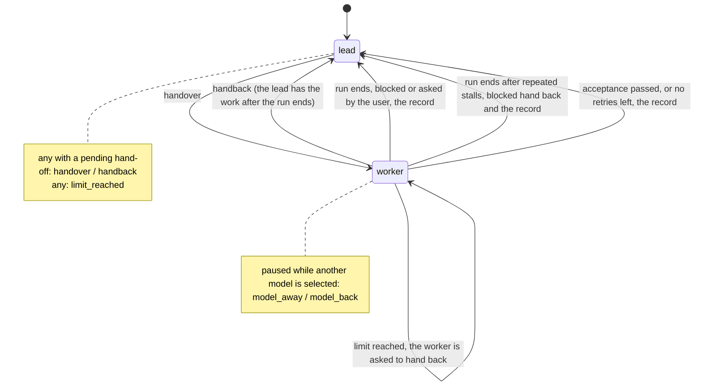

# Relay

Relay is a [virtual model](virtual-models.md), `relay/auto`, that runs one conversation on two models. A strong model,
the **lead**, explores, decides the plan and reviews the result. A cheap model, the **worker**, carries the plan out.
The lead's tokens go to judgement; file reads, test output and mechanical edits go to the worker.

```
xpi --model relay/auto
```

or `/model relay/auto` in a session. The footer shows which model answers. The built-in `relay` extension provides it;
`-builtin:relay` in `extensions` turns it off.

Relay is for transparency, observability and saving money. Both models work in one session, so the work of both stays
on record: the hand-back compaction changes only what the lead's later requests read, and the worker's steps stay in the
session file, in the scrollback and in `/tree`. Every phase change and every repair of a mistake is an entry on the
branch and a line on screen (see [Repairs and what you see](#repairs-and-what-you-see)). Orchestrating several agents is
the job of [workflows](subagent.md#workflows), not of relay: there is one worker at a time.

## How a task runs

```
lead explores → tools.handover({ plan, acceptance, findings })  (from a codemode script)
             → worker builds
             → acceptance commands run; on failure their output goes back to the worker
             → the conversation is compacted to a hand-back record
             → lead reads the record → answers / fixes a small thing / hands over again
```

1. **The lead explores and plans.** It reads what the decision depends on. Whether to hand over at all is its
   decision (see [What the lead is told](#what-the-lead-is-told)); when it does the work itself, nothing below happens.
2. **Handover.** The lead calls `tools.handover({...})` from a [codemode](codemode.md) script. The call ends the
   script and the lead's turn. From the next request on the worker answers. It reads the whole conversation, once and
   uncached, so nothing is lost in a brief.
3. **The worker builds** and calls `tools.handback({...})` from a script with a report, or simply stops.
4. **Acceptance.** xpi runs the handover's acceptance commands in the session's directory. If one fails, the output goes
   back to the worker and it continues, at most `maxRounds` times. A worker that hands back `blocked` skips this step.
5. **Hand back.** The conversation is compacted to the hand-back record, and the lead is asked to review. Nothing of the
   worker's transcript (the files it read, its failed attempts, its test runs) reaches the lead.

<!-- relay-diagram:start (generated by npm run generate:relay-docs; do not edit) -->

<!-- relay-diagram:end -->

A user message during a worker phase goes to the worker: you are talking to the model that is doing the work. Use
`/handback` to reach the lead.

## What each role is told

While `relay/auto` is selected, every request carries a section named `relay` in the leading system message. It is
built from the router state stored on the session branch, so retries, `/tree` jumps and an ordinary compaction in a
worker phase all give the right role, and it is the same text for every request of a role in a round, so each model's
cached prefix stays stable. When another model is selected the section is removed.

- **The lead's section**: one line (`You are the lead in relay mode; the worker is <model>. To give the work away call
  tools.handover({...}) from codemode.`), `handover`'s fields, and the decision facts below. It names no way to call
  `handback`.
- **The worker's section**: one line (`You are the worker in relay mode. When done or stuck, call tools.handback({...})
  from codemode.`), a statement that the handover has already happened, that the assistant messages before the handover
  (a tool result that contains `Handed over to the worker model (round N)`, or its mention in a summary of this
  conversation; after a `/handover` by the user, the `<relay-handover-by-user>` line) were written by the lead (a
  different model) and not by the worker, that it must
  not continue them or wait for a worker, and that it starts on the plan now, `handback`'s fields, the handover as the lead wrote it (plan, criteria, findings, when to stop, the
  acceptance commands), and its duties. The plan is here, not only in the lead's script, so a compaction cannot
  summarize it away. It names no way to call `handover`, and no message is inserted into the conversation at a handover
  to tell the worker its role.

## What the lead is told

No rule says when to hand over. The lead's section gives it what a decision needs, and the decision is the lead's:

- **The objective**: `relay.objective`. By default, a correct result for as few lead tokens as possible, with worker
  tokens not counted.
- **The prices**: the API list prices of both models per million tokens (input, cached input, cache write, output,
  and the higher tier of a model that has one), and how many times a lead token costs a worker token. They are read
  from the model catalog, so they follow the models you configure. For example, with Opus 5.5 as lead and Haiku 5.5 as
  worker: input $4 against $0.1, output $20 against $0.5, 40 times each. With a pair of models whose prices are not
  known, it says so.
- **The worker's context**: where the worker's price rises (its first price tier, with the number of prompt tokens and
  how many times dearer its input tokens are above it), that its context grows with what it reads and writes in one
  round and starts again after a hand back, and the limit in force with what happens when the worker is stuck (for
  example `Worker context limit: 95,000 tokens; after 4 compactions in a round it is lifted`; `none` when there is
  no limit). The lead's own limit is told too (`Your own context limit: 300,000 tokens; ...`), in tokens, not as a percentage; it is there
  unless the lead has no limit (`"off"`, a model without a window, or a default that does not apply to its model). See
  [The worker's context limit](#the-workers-context-limit).
- **Time**: what a round adds (the worker's first read of the conversation, its work, the acceptance commands, the
  lead's reading of the record). Time is part of the objective only when `relay.minuteCost` is set: the lead is then
  told what one minute of your waiting is worth in dollars of tokens, and can weigh it against the prices.
- **What a handover does**: the worker reads the whole conversation and works until it hands back or stops; the
  acceptance commands are run, and a failure goes back to the worker at most `maxRounds` times.
- **What comes back**: what the record keeps as written, what is new in it, and what is not kept (the worker's steps,
  and the tool output the lead read before the handover).
- **That nothing is final** after a hand back: the lead can read, change things itself, or hand over again.
- **About the worker**: `relay.workerRecord`, when set. For example a measured result of the worker model on tasks
  of this project.

After each hand back the lead is also told what was measured: how long the round took from the handover to the hand
back, how much of that the acceptance commands took, and what each model has used in the session so far (requests,
tokens by kind, cost, time in requests and output tokens per second). So from the second decision on, the lead
knows the cost and the speed of a round in this very session. It is also told what the round did to the worker's
context: the peak prompt, how many summaries were written under the limit, and whether the limit was lifted or the
worker was asked to hand back (a line such as `The worker's context peaked at 92,000 prompt tokens (limit 95,000); 2
summaries were written under the limit; the limit was lifted.`).

A stronger model needs no more than this; a setup where the lead decides badly is corrected by changing these facts,
not by adding rules. `npm run eval:delegation` measures the decisions (see [Limits](#limits)).

## The two tools

Both are `deferred`, [unlisted](codemode.md#unlisted-tools) tools: they are not declared to either model and are in no
codemode listing, `ALL_TOOLS` or `searchTools()`. A script calls them by name (`await tools.handover({...})`), and each
role learns only its own tool from its prompt. They refuse to run unless `relay/auto` is selected. Both end the turn:
the script stops at the call and the loop stops after the response; other tool calls of the same response finish. The
result of `handover` is one neutral line (`Handed over to the worker model (round N): from the next message on the
worker answers; the messages above were written by the lead.`) and nothing else: the model sees no marker. The
handover itself is the structured `signal: { type: "relay.handover", data: { round: N } }` of the result, which the
session keeps on the tool result message and never sends to a model (see
[Extensions](extensions.md#custom-tools)). A codemode result takes the signal of the call that ended the script, and a
direct call that the agent loop runs as a codemode call keeps it, so the router takes a handover from the signal of a
`handover` or `codemode` result that names the next round (a file the worker reads that contains a marker string
carries no signal and does not count). Sessions written before the signal ended such a result with the line
`<relay-handover round="N"/>`; the router and the landing check still accept that line as the last line of a `handover`
or `codemode` result, so those sessions continue.

**With codemode off** (`-codemode`, or the tool not active) both roles see both tools, because they are ordinary
direct tools (the one-tool-per-role rule needs codemode); they are registered as `direct` tools and the
prompt says `call handover({...})`. Exposure is fixed at registration, so relay checks at `session_start`,
`model_select` and `before_agent_start` and registers the tools again only when codemode's state changed. `/relay` says
`codemode is off: the hand tools are direct tools`.

**`handover`** (lead)

| Field | Meaning |
|---|---|
| `plan` | The steps, in order, specific enough to follow without the lead. |
| `acceptance` | Shell commands that must exit 0 when the work is done (tests, a type check, a grep). Optional. |
| `criteria` | What done means beyond the commands. The lead reviews the result against it. |
| `findings` | What the lead learned and must not lose: the files involved, constraints, traps. |
| `stopWhen` | When the worker must stop and hand back instead of pushing on. |

**`handback`** (worker): `status` (`done` or `blocked`) and `report`. A worker run that ends without the call counts as
done, with its last message as the report.

Two calls in one response make one hand-off. A second `handover` in the same script never runs, because the first ends
the script. In a second parallel codemode call it answers `Already handed over.` (or `Already handed back.`), which is no
error and no mix-up.

The acceptance commands are written by the model and run without asking, like the model's own `bash` calls.

## The hand-back record

The record replaces the conversation. It holds, in this order:

- the summary of an earlier ordinary compaction, if there was one;
- the user's messages and the lead's replies, as written, without tool activity (when they exceed 40,000 characters,
  the oldest lead replies are dropped first; the user's messages stay);
- one line per earlier round;
- the lead's handover note, word for word;
- the worker's report;
- one line for each repair of the round (a corrected call, a continuation, a direct call), so the lead knows when the
  worker needed help;
- the worker's context line under `## Worker context` (the same line the review message carries), when it has
  something to say;
- the changes since the handover: `git diff --stat`, files git does not track, and the diff up to `diffChars`
  characters (beyond that the lead is told how to read the rest). Outside a git repository this part is empty;
- each acceptance command with its exit status and the end of its output.

The lead's own judgement is kept in its own words; the worker summarizes only its own work; the rest is output of
commands.

## The worker's context limit

Measured on eight long tasks (see [Measured](#measured)), 71 percent of a session's cost was the worker's, and 92
percent of that came from requests above 100,000 prompt tokens, where Haiku 5.5 costs five times as much per token.
Relay therefore limits the worker's context to its model's first price tier by default.

- **The limit** is read from `relay.workerContext`: `"tier"` (default) is `tierFraction` (0.95) of the lowest
  `cost.tiers[].inputTokensAbove` of the worker model in the catalog, so 95,000 tokens for Haiku 5.5; a model without
  tiers, or one that is not in the catalog, has no limit. A number is that many prompt tokens, `"off"` is none. A
  percentage string such as `"30%"` or `"12.5%"` (above 0, at most 100) is that share of the model's `contextWindow`
  in the catalog, rounded down; a model outside the catalog or without a window has no limit. Any other string
  (`"30"`, `"0%"`, `"101%"`, `"abc%"`) is an error that names the key and lists these forms. The lead has the same
  four forms under `relay.leadContext`, and its default is `"30%"`: 300,000 tokens for Opus 5.5 (window 1,000,000).
  In the measured tasks the lead peaks at about 2.4 percent of its window (22,000 to 24,000 tokens), because the
  hand-back record replaces the conversation, so the default is a backstop for a lead that does not hand over or for
  a long conversation with the user in a lead phase. The lead's section states its limit in tokens. The default
  applies only where it comes to at least 100,000 tokens: with a smaller window (200,000 tokens gives 60,000) the lead
  would compact every few turns without anyone having asked for a limit, so there the lead has no default limit and
  the ordinary threshold applies. A limit you set yourself is used as written. An existing session whose lead context
  is already above the limit is compacted before its next lead request (the summary is written by the worker model).
- **How it works**: `route()` returns the limit as `contextLimit` on the route of a worker (or lead) request. The
  agent core compacts before the request when the context exceeds the smaller of that limit and its usual threshold,
  and writes it on the compaction entry. Old tool output is pruned first, and a summary is written only when pruning
  does not get the context to 90 percent of the limit (see [Compaction](compaction.md#a-route-context-limit) and
  [Virtual models](virtual-models.md#limit-the-context)). The summary replaces the worker's conversation; the
  handover itself is in the worker's system prompt, so it is not lost.
- **A limit must be reachable**: a computed limit below `compaction.keepRecentTokens` plus 20,000 tokens (40,000 with
  the defaults; the value resolved for `relay/auto`) is an error that names the key, for a number, for a small
  percentage (`relay.<key>.limit`) and for a small `tierFraction` alike. A limit a compaction cannot get under would
  compact on every request. That is for a limit the settings chose: a built-in default that does not fit (the
  worker's tier under a large `keepRecentTokens`, or the lead's share of a small window) means no limit for that
  role, and the ordinary compaction threshold applies. The worker's limit is
  checked in the lead phase too, so the error comes before the first handover; the lead's own limit is checked only
  in the lead phase.
- **The stuck guard**: relay counts the summaries written under the limit in the current phase, from the compaction
  entries that carry `contextLimit`: after the latest handover for the worker; for the lead, after the later of the
  latest hand back and your latest message (a lead that compacts over hours of conversation is not stuck). The count follows the branch, so a failed acceptance run (which starts no new
  round) carries it across. When it reaches `maxCompactions` (default 4; `0` turns the guard off), `route()` returns
  a state with `limit: "lifted"` (or `"asked"`, below) and no limit for that request; `onRequestStart` sees the change
  and runs the `limit_reached` row of the [table](#the-transition-table): a `relay.limit` entry
  (`{ round, phase, action, compactions }`) and a notification. `route()` writes nothing itself.
  - `whenStuck: "lift"` (default): the limit is lifted for the rest of the round, one entry and the line `relay:
    worker compacted 4 times in round N, limit lifted`.
  - `whenStuck: "handback"` (worker only): the worker gets one steering message that asks it to hand back `blocked`
    with what is done and what is left, so the lead can split the rest; the limit stays. It is no stall or mix-up, and
    a `/handback` by you in the same round takes precedence (no message is sent). If the worker has not handed back
    after two more summaries, the limit is lifted as above.
  - The lead is never asked to hand back: its limit is lifted, until the next handover or your next message.
  - A new handover resets the count and the lift. A state stored before this field existed reads as limited.
- **Pruning alone** is not counted and not capped: each pass needs `compaction.prune.minSavingsTokens` of old tool
  output, so it cannot repeat without new output.
- **The record**: a summary written under a limit in a worker phase is the worker's working memory, not the lead's.
  When the hand-back record is built, such summaries are not carried into it as the lead's earlier summary; a summary
  under the lead's own limit is kept, as an ordinary compaction is.
- **The estimate** right after a prune or a compaction is characters divided by 4 for the whole context, which tends
  to undercount code and JSON, so a request just after one can still go out above the tier. The prune shortcut leaves
  10 percent of headroom; the eval counts the worker's requests above the tier, so the size of the effect is measured.

```json
{ "relay": { "workerContext": { "limit": 60000, "whenStuck": "handback" }, "leadContext": { "limit": "20%" } } }
```

## The transition table

One pure function, `transition(view, event, config)` in `packages/xpi-relay/src/definition.ts`, decides every phase
change. It is a list of rows on a small internal graph engine (`src/graph/`): the engine refuses a definition that
names an undeclared state or event or holds a row that can never match, and the table and the diagram above are
generated from the rows (`npm run generate:relay-docs` in `packages/xpi-coding-agent`; a test fails when they are
stale). The code in `relay.ts` reads the session into a view, calls it, and carries out the effects it returns (a tool
result, an entry, the acceptance commands, the compaction, a continuation, a notification). The view is the router state stored on
the branch plus what relay's entries add: wrong-role calls and continuations so far in the round, a pause, and a
pending hand-off (a `relay.handover` or `relay.handback` entry written after the latest router-state, `relay.transition`
or `relay.verify` entry: the stored state changes only at the next request). Where two rows match, the earlier wins;
every other pair changes nothing and answers with a refusal.

<!-- relay-table:start (generated by npm run generate:relay-docs; do not edit) -->
| View | Event | Next | Effects |
|---|---|---|---|
| any with a pending hand-off | handover / handback | unchanged | result "Already handed over/back." (no error, not counted) |
| any, paused | handover / handback | unchanged | refusal "The relay is paused: select relay/auto again." |
| worker | handover | unchanged | refusal "The worker already has the work." |
| lead | handover | pending worker, round + 1 | `relay.handover` entry; a `relay.handover` signal on the result; the turn ends |
| lead | `/handover` (by the user) | pending worker, round + 1 | `relay.handover` entry; the host sends the user's message that starts the worker |
| lead | handback | unchanged | refusal "The lead already has the work." |
| worker | `/handback` (by the user) | user asked: the acceptance commands are skipped | steer: ask the worker to stop and report |
| worker | handback | pending hand back | `relay.handback` entry; "Handed back."; the turn ends |
| any, paused or with a pending hand-off | wrong role | unchanged | refusal "Not now." |
| worker | wrong role (handover), first time | mixups 1 | `relay.mixup`; an error with the correction |
| worker | wrong role (handover), second time | pending hand back, blocked | `relay.mixup` and a blocked `relay.handback` ("The worker mixed up its role twice"); the turn ends |
| lead | wrong role (handback) | mixups + 1 | `relay.mixup`; an error with the correction (the lead is never handed back for) |
| any, paused | run ends | unchanged | none |
| lead, run ends with a pending handover whose result did not carry the signal | run ends | pending voided | `relay.void`; a line; the lead goes on |
| lead, run ends with a pending handover | run ends | unchanged | continue: the worker answers next |
| lead | run ends after a relay error, stalls < 2 | stalls + 1 | `relay.stall`; continue with a role reminder |
| lead | run ends after a relay error, stalls = 2 | unchanged | none: the run ends; you see it |
| worker, a blocked hand back or one the user asked for | run ends with a pending hand back | lead, mixups 0, stalls 0 | compact to the record; `relay.transition` (no acceptance commands) |
| worker | run ends with a pending hand back | acceptance | run the acceptance commands |
| worker | run ends after a relay error, or with no tool call since the handover and no hand back (text only); stalls < 2 | stalls + 1 | `relay.stall` (reason `error` or `idle`); continue with a role reminder (`idle`: that the handover happened) |
| worker | the same, stalls = 2 | hand back, blocked | a blocked hand back ("The worker stopped after relay errors" or "...without doing any work") and the record |
| worker, blocked or the user asked | run ends (otherwise) | lead, mixups 0, stalls 0 | compact to the record; `relay.transition` (no acceptance commands) |
| worker | run ends (otherwise) | acceptance | run the acceptance commands |
| worker | acceptance failed, failures so far < `maxRounds` | unchanged | `relay.verify`; continue with the failure output |
| worker | acceptance passed, failed at `maxRounds`, or nothing to run | lead, mixups 0, stalls 0 | compact to the record; `relay.transition` |
| worker | stuck guard: the worker's context limit compacted `maxCompactions` times, `whenStuck` is `handback` | limit asked (the limit stays; lifted after two more summaries) | `relay.limit` entry (`handback`); notification; steer: ask the worker to hand back `blocked` with what is done and left |
| any | stuck guard: `maxCompactions` summaries under the limit (worker: `whenStuck` is `lift`, or two more after the ask) | limit lifted until the next handover (lead: or the next user message) | `relay.limit` entry (`lifted`); notification |
| worker | another model selected | paused | `relay.pause`; notification |
| paused | `relay/auto` selected | worker | `relay.resume`; notification |
<!-- relay-table:end -->

A lead that gets `another model selected` or `relay/auto selected` has nothing to pause or resume: those two events change
nothing in the lead's phase.

Notes: a handover resets mixups and stalls. Whether a run "ends after a relay error" is read from the `relay.mixup`
entry (inside a script the error is a nested result): only a wrong-role call counts, so a lead that stops after another
relay error, such as an empty plan, is not continued: that is its call. One row is not in the lead's request path:
after a `handover` ends the lead's turn, the run ends with a pending handover and relay continues it, so the worker
answers next. Relay continues it only when a tool result really carries the signal of the next round (or, in an older session, ends with its marker line); a handover whose call
was cut off (an unawaited call, Esc) is voided with a `relay.void` entry and a line, and the lead goes on. `/handback` sets a flag and asks the worker to report; the worker's own `handback` in the same phase
supplies the report, and the flag skips the acceptance commands, so racing the two is one hand back.

## Repairs and what you see

A mistake of a model is repaired by a hook, without a request of the strong model where possible, and nothing a hook
repairs or decides is silent. None of it enters a model's context as a message: transitions and repairs are `custom`
entries on the branch (they cost no tokens and do not touch the cached prefix) and `ui.notify` lines. In print mode the
lines go to stderr with `--verbose`.

- **A phase change**: a `relay.transition` entry (`from`, `to`, `event`, `round`, `at`) and one line, for example
  `relay: lead → worker (round 2)`. A handover is recorded at the `request_start` event of the request the worker
  answers, so the entry follows the router-state entry of that request; the router itself (`route`) writes nothing, and
  nothing is written when the worker model cannot be resolved. A retry of that request writes no second entry. The
  hand back is recorded where its record is made, at the end of the worker's run.
- **A direct call** of `handover` or `handback` while codemode is on is run as a codemode call by the agent loop, with a
  note on the first line of its result (see [Codemode](codemode.md#a-direct-call-of-a-tool-only-scripts-can-reach)): a
  `relay.direct` entry and `relay: direct handover(...) run as a codemode call`. The result still carries the signal,
  so the handover counts.
- **A wrong-role call** (the worker calls `handover`, the lead calls `handback`): a `relay.mixup` entry and
  `relay: worker called handover, corrected (1 of 2)`. The error names the caller's own tool. The worker's second one
  hands back as `blocked`: `relay: roles mixed up twice, handed back as blocked`.
- **A text-only answer after a handover**: a worker that ends its run without any tool call since the handover and
  without a hand back took the lead's earlier messages for its own. It is not verified: it is continued with a reminder,
  as after an error, at most twice, then handed back as `blocked`: a `relay.stall` entry (reason `idle`) and
  `relay: worker stopped without working, continued (1 of 2)`. Not applied after `/handback`.
  A worker that answers with text only is continued twice, then handed back as `blocked`; this includes a round that
  needs no tool (`/handover explain X`). Write such a round so that the worker hands back with `tools.handback`: the
  reminder tells it to.
- **A stop after such an error**: continued with a short role reminder, at most twice: a `relay.stall` entry and
  `relay: worker stopped after an error, continued (1 of 2)`. The correction or reminder goes to the model that erred.
- **A pause**: `relay paused (worker phase, round N)` and `relay resumed (worker phase, round N)`.

`/relay` shows who has the work and the two models, this round's transitions and repairs with their ages, and what each
model has used in the session (the numbers the lead gets after a hand back). The hand-back record lists the round's
repairs, once.

## Switching models

`/model` to another model in a worker phase pauses the relay: a `relay.pause` entry and a notification. The other
model sees neither relay text nor the tools (they refuse to run). Selecting `relay/auto` again writes `relay.resume`
and the worker answers the next request.

## What the lead pays for

| Step | Lead tokens |
|---|---|
| Exploring and planning | Its own reading and thinking. Wide searches can go to cheap scouts with the [`Agent`](subagent.md) tool. |
| `handover` | The note it writes. |
| Worker phase, acceptance rounds | None. |
| Worker phase, prefix refreshes | With `relay.warmLead` (default), short refresh requests that keep the lead's cached prefix alive, while that costs less than writing it again (see [The lead's cached prefix](#the-leads-cached-prefix)). |
| Hand back | The system prompt and tools from the prompt cache while it is alive (5 minutes by default), plus a cache write of the record. |

After a hand back every later lead request reads the record, not the conversation it replaced.

### The lead's cached prefix

A worker phase can last longer than the prompt cache lifetime (5 minutes by default), so the lead's cached prefix, its
tools and system prompt (about 6,000 tokens in the measured tasks), would be written again on the first request after
the hand back. The record replaces the lead's conversation, so the prefix is all the next lead request reads again.

With `relay.warmLead` (default `true`), `route()` labels the lead's requests `lead` and the worker's requests `worker`,
and the worker's label asks the core to hold the `lead` prefix (`ModelRoute.cache`, see [Virtual models](virtual-models.md#keep-a-prefix-cached)).
The core then sends a short refresh request with the lead's tools and system prompt and one short user message before
the entry expires, as long as the refreshes cost, in all, less than writing the prefix again would add to reading it.
Each refresh is a `cache_warm` usage entry on the branch with the note `held prefix: lead`. It counts toward the
session cost and never enters the context. `/relay` shows how many refreshes there have been and what they cost, and
the delegation eval prints the same per task, with the lead's cache read and cache write on its first request after
each hand back. The saving is not measured yet: the real-model validation is pending, and `warmLead` stays at its
default until it is.

The hold ends when the lead sends its next request, when the run settles (a session you leave idle holds nothing; if
you interrupt the worker and resume later, nothing is held until the next lead request), when another model is
selected, when the session branch changes, and when the session is disposed. `cacheWarming: "off"` disables it, as for
the ordinary warmer.

The refresh pays only if the first lead request after the hand back sends the same tools and system prompt as the
lead's last request before the handover. A suite test pins that for a session that starts under `relay/auto`. It does
not hold, and the refreshes are wasted, in these cases: relay selected in the middle of a session, tools added during
the lead phase, and a codemode switch during the round. The waste is bounded by the economics rule: at most one cache
write of the prefix.

### Measured

`npm run eval:delegation -- --long`, 2026-11-10, Opus 5.5 as lead and Haiku 5.5 as worker, on six features of this
repository built again from their spec (about 1,200 changed lines over 20 files in the original unless noted; done
when the offline subagent suite passes). One run per cell, so differences of 10 to 20 percent mean nothing.

| Task | Way of working | Passed | Time | Opus cost | Haiku cost | Handovers |
|---|---|---|---|---|---|---|
| fork agent type | Opus alone | yes | 365 s | $1.52 | | |
| | Haiku alone | yes | 676 s | | $0.71 | |
| | relay, the lead decides | yes | 472 s | $0.21 | $0.26 | 1 |
| | relay, told to hand over | yes | 624 s | $0.18 | $0.10 | 1 |
| names and SendMessage | Opus alone | yes | 282 s | $0.93 | | |
| | Haiku alone | yes | 502 s | | $0.11 | |
| | relay, the lead decides | yes | 345 s | $0.19 | $0.06 | 1 |
| | relay, told to hand over | yes | 717 s | $0.24 | $0.04 | 1 |
| agent file fields | Opus alone | yes | 332 s | $1.15 | | |
| | Haiku alone | yes | 540 s | | $0.18 | |
| | relay, the lead decides | yes | 526 s | $0.24 | $0.33 | 1 |
| | relay, told to hand over | yes | 778 s | $0.22 | $0.15 | 2 |
| saved workflows (2,600 lines) | Opus alone | yes | 845 s | $3.70 | | |
| | Haiku alone (2 runs) | yes | 1,118 s | | $1.63 | |
| | relay, the lead decides | yes | 833 s | $0.24 | $0.90 | 1 |
| relaunch and pause | Opus alone | yes | 700 s | $2.74 | | |
| | Haiku alone (2 runs) | yes | 880 s | | $1.04 | |
| | relay, the lead decides | yes | 1,000 s | $0.24 | $0.96 | 1 |
| structured output (1,600 lines) | Opus alone | yes | 293 s | $1.02 | | |
| | Haiku alone (2 runs) | yes | 322 s | | $0.13 | |
| | relay, the lead decides | yes | 447 s | $0.21 | $0.23 | 1 |

- With the facts above and no rule, the lead handed over in all six tasks, after 2 to 8 requests of its own. Its
  cost stayed between $0.19 and $0.24 whatever the size of the task: 6 to 21 percent of what it spent alone.
- The time was longer than Opus alone in five of six tasks. It was shorter than Haiku alone in four and longer, by
  about two minutes, in two: a round is the lead's exploring, the worker's work and the lead's review, and the
  worker's part alone takes about what the worker needs without a lead.
- With the earlier prompt, which told the lead when to hand over but gave it neither prices nor an objective, the lead
  never handed over in the first three tasks: relay cost the same as Opus alone.
- Haiku alone passes all six tasks. They show what a handover costs and saves, not what the lead's judgement is
  worth on a task the worker cannot do by itself. Against Haiku alone, relay buys the lead's plan and review for
  about twenty cents; against Opus alone, it saves most of the lead's cost for more time.
- Haiku's cost on the larger tasks is far from one fortieth of Opus's: it makes many more requests, and its price is
  five times higher above 100,000 prompt tokens.
- In the same evaluation neither model started a subagent with the `Agent` tool on its own, in ten small tasks and
  six long ones, with or without prices and an objective in the tool's description. The small tasks meant for
  delegation (a search over 40 files, a 3,000-line log) were done with one codemode script for a few cents.

### Measured: the worker's context

`npm run eval:delegation -- --long --arms relay`, 2026-11-15, Opus 5.5 as lead and Haiku 5.5 as worker, one run per
task, so only differences of 50 percent and more mean something. First round, no limit: all eight tasks passed
($4.59 in 3,752 s); the lead cost $1.33 (29 percent) and the worker $3.25 (71 percent). 203 of the worker's 345
requests had more than 100,000 prompt tokens and made up $3.00 of its cost (92 percent). No compaction happened in
any worker phase; the worker's peak context reached 294,308 tokens (`workflows`).

| Task | Worker requests above 100k / all | Worker cost below / above 100k | Worker peak context |
|---|---|---|---|
| fork agent type | 38 / 55 | $0.03 / $0.45 | 179,879 |
| workflows | 73 / 90 | $0.03 / $1.28 | 294,308 |
| relaunch and pause | 56 / 70 | $0.03 / $0.94 | 263,795 |
| agent file fields | 25 / 49 | $0.04 / $0.21 | 134,558 |
| structured output | 8 / 31 | $0.04 / $0.08 | 128,886 |
| names and SendMessage | 3 / 21 | $0.04 / $0.03 | 104,532 |
| audit three packages | 0 / 21 | $0.02 / $0.00 | 47,833 |
| three libraries from specs | 0 / 8 | $0.02 / $0.00 | 46,824 |

The lead handed over after one or two requests, with 7,000 to 12,000 tokens of context, so appending the record to its
conversation instead of replacing it would have changed nothing. Second round, the worker limited to 95,000 tokens (a
compaction override on `relay/auto`, which was the only way before the route limit existed):

| Task | No limit | Limit 95,000 | Compactions | Result |
|---|---|---|---|---|
| fork agent type | $0.71, 590 s | $0.33, 523 s | 2 | passes, 53 percent cheaper |
| relaunch and pause | $1.16, 778 s | $0.42, 1,165 s | 6 | passes, 64 percent cheaper, 50 percent slower |
| workflows (2,600 lines) | $1.47, 1,014 s, passes | $0.66, 2,700 s | 6, then 10 | times out |

In the task that timed out, a compaction happened every two to three minutes: each keeps the latest 20,000 tokens
and a summary, and the worker reads its way back to the limit. That run wrote a summary after every prune; the
default now prunes first and writes a summary only when pruning is not enough, and the stuck guard lifts the limit
after four summaries. The numbers above are from before those two changes. With them, at the default settings, two
runs per task (Opus 5.5 as the lead, Haiku 5.5 as the worker):

| Task | No limit (1 run) | Default limit (mean of 2) | The two runs | Limit summaries | Guard |
|---|---|---|---|---|---|
| fork agent type | $0.71, 590 s | $0.34, 598 s | $0.28 and $0.39 | 2 and 3 | not reached |
| relaunch and pause | $1.16, 778 s | $0.53, 1,208 s | $0.37 and $0.69 | 4 and 4 | lifted in both |
| workflows (2,600 lines) | $1.47, 1,014 s | $0.61, 1,433 s | $0.52 and $0.70 | 4 and 6, over 3 and 4 rounds | not reached |

- All six runs pass; `workflows` does not time out. The cost is 53, 54 and 58 percent lower, and the last two tasks
  take 40 to 55 percent longer.
- In `workflows` the lead split the work itself, into three and four handovers; no worker round passed 100,000
  tokens. With one handover (the two `diffChars` runs below) the guard lifts the limit, the worker grows to 228,000
  and 278,000 tokens and the run costs $1.12 and $1.27: 14 to 24 percent below the unlimited run, not 58.
- In `relaunch and pause` the limit was lifted after four summaries in both runs. In one the worker stayed below the
  tier afterwards ($0.37); in the other it grew to 153,000 tokens with 35 requests above the tier ($0.69).
- In the seven runs where the limit was never lifted (four of these six and three of the `diffChars` runs), no
  request went above the tier: the worker's peak was 93,000 to 99,000 tokens against a tier of 100,000 and a limit of
  95,000, so the estimate's error stayed inside the headroom there.
- One of the two `fork agent type` runs was flagged by the eval for reading this checkout's source; it is the dearer
  of the two ($0.39), and the other costs $0.28.

`relay.diffChars` at 5000 and 0 was tried once per task. The lead's cost after the hand backs followed the number of
rounds, not the size of the diff, so the default stays 20000.

## Commands

| Command | Description |
|---|---|
| `/handover [instructions]` | Give the work to the worker now, without a plan from the lead. |
| `/handback` | Wake the lead now: the worker is told to stop and report, and the acceptance commands are not run. |
| `/relay` | Show who has the work, the round, the two models, this round's transitions and repairs, the spend of each model, and the refreshes that kept the lead's prefix warm. |

## Settings

```json
{
  "relay": {
    "lead": "anthropic/claude-opus-5-5",
    "worker": "anthropic/claude-haiku-5-5",
    "leadThinking": { "plan": "high", "review": "medium" },
    "workerThinking": "medium",
    "maxRounds": 3,
    "acceptanceTimeoutMs": 600000,
    "diffChars": 20000,
    "workerContext": { "limit": "tier", "tierFraction": 0.95, "maxCompactions": 4, "whenStuck": "lift" },
    "leadContext": { "limit": "30%" },
    "warmLead": true,
    "objective": "the user wants a correct result for as few of your (lead) tokens as possible. Worker tokens are not counted."
  }
}
```

| Key | Default | Meaning |
|---|---|---|
| `lead` | `anthropic/claude-opus-5-5` | The model that explores, plans and reviews, as `provider/model`. |
| `worker` | `anthropic/claude-haiku-5-5` | The model that builds. It also writes the summary of an ordinary compaction. |
| `leadThinking.plan` | `high` | The lead's thinking level before the first handover. |
| `leadThinking.review` | `medium` | The lead's thinking level after a hand back. |
| `workerThinking` | `medium` | The worker's thinking level. |
| `maxRounds` | `3` | Times failed acceptance commands go back to the worker before the lead is woken regardless. `0`: never. |
| `acceptanceTimeoutMs` | `600000` | Time limit of one acceptance command. |
| `diffChars` | `20000` | How much of the diff goes into the record. `0`: the stat only. |
| `objective` | see above | What the user optimizes for, told to the lead. Change it to weigh time, or to count worker tokens. |
| `workerRecord` | unset | What is known about the worker's ability, told to the lead. |
| `minuteCost` | unset | What one minute of your waiting is worth, in dollars of tokens. Unset: time is not part of the objective. |
| `workerContext.limit` | `"tier"` | The worker's context limit: `"tier"` (`tierFraction` of its model's first price tier; none without tiers), a number of prompt tokens, a percentage of the model's context window such as `"30%"` (none without a window), or `"off"`. |
| `workerContext.tierFraction` | `0.95` | The part of the tier used with `"tier"`, above 0 and at most 1. |
| `workerContext.maxCompactions` | `4` | Summaries under the limit in one round before `whenStuck` applies. `0`: the guard is off. |
| `workerContext.whenStuck` | `"lift"` | `"lift"`: lift the limit for the rest of the round. `"handback"`: ask the worker to hand back with a progress report; the limit is lifted after two more summaries. |
| `leadContext.limit` | `"30%"` | The same four forms, for the lead's own context. The default is 300,000 tokens for Opus 5.5; the lead peaks at about 2.4 percent of its window in the measured tasks, so it is a backstop. Where 30 percent of the window is under 100,000 tokens the lead has no default limit. |
| `leadContext.tierFraction`, `leadContext.maxCompactions` | `0.95`, `4` | As for the worker. A stuck lead always has its limit lifted, until the next handover or your next message. |
| `warmLead` | `true` | Keep the lead's cached prefix warm with short refresh requests during a worker phase, while that costs less than writing it again. Must be `true` or `false`. |

The values are read at each request, so a change applies to the next one. A wrong value ends the request with an
error that names the key; a context limit below `compaction.keepRecentTokens` plus 20,000 is one too. The thinking level selected for `relay/auto` itself is not used.

## Limits

- One worker at a time. The lead can start parallel agents with the `Agent` tool.
- The phase is router state on the session branch: a fork or a `/tree` jump sees the phase of its own branch.
- Esc during a worker phase leaves the work with the worker. The next message goes to it; `/handback` wakes the lead. A
  handover whose response was cut short (Esc, an error before its result was written) leaves the phase as it was.
- A worker run that ends in a provider error is not handed back. Send a message to let the worker continue.
- Subagents do not get the relay model or its tools.
- Tests: `packages/xpi-relay/test/` (every row of the table, every combination of overlays and events, the host interface against a fake host), `test/suite/relay.test.ts` (faux provider), `npm run test:relay:real` (real models; both roles are Haiku
  unless `RELAY_TEST_LEAD` names another model).
- `npm run eval:delegation -- --long` runs long tasks (features of this repository built again from their spec) three
  ways: the main model alone, with the `Agent` tool, and as the lead of `relay/auto`. It reports the result, each
  model's tokens and cost, and how often the model delegated or handed over. `EVAL_MAIN` names the main model
  (default Haiku); `--force` tells the model to delegate, for comparison with its own decision. Two multi-agent
  tasks run through `xpi --mode rpc`, where scripts can run in the background, and also report how main waited for
  its agents (see [Subagents: Waiting for agents](subagent.md#waiting-for-agents)); `--cli <path>` runs another build.
  A failing run keeps its directory (repository and sessions); `EVAL_KEEP=1` keeps those of passing runs too.
  `EVAL_SETTINGS=<json>` merges settings into every run, one level deep (`{"relay":{"workerContext":{"limit":"off"}}}`
  keeps the arm's models and thinking levels). For the relay arm the report adds the worker's peak context, its
  requests above its first price tier and the summaries written under its limit.

## Porting

The relay is the private package `xpi-relay` (`packages/xpi-relay`), which imports nothing of the coding agent; the
built-in extension is the adapter that implements the package's `RelayHost`. It is one entry of
[Porting xpi features](porting.md#relay): what it needs from the host (a virtual model, the
`agent_before_settle` boundary with a compaction draft, codemode with nested `terminate`, unlisted tools and the
direct-call repair of the agent loop), what to copy and rename, and how to verify it.
