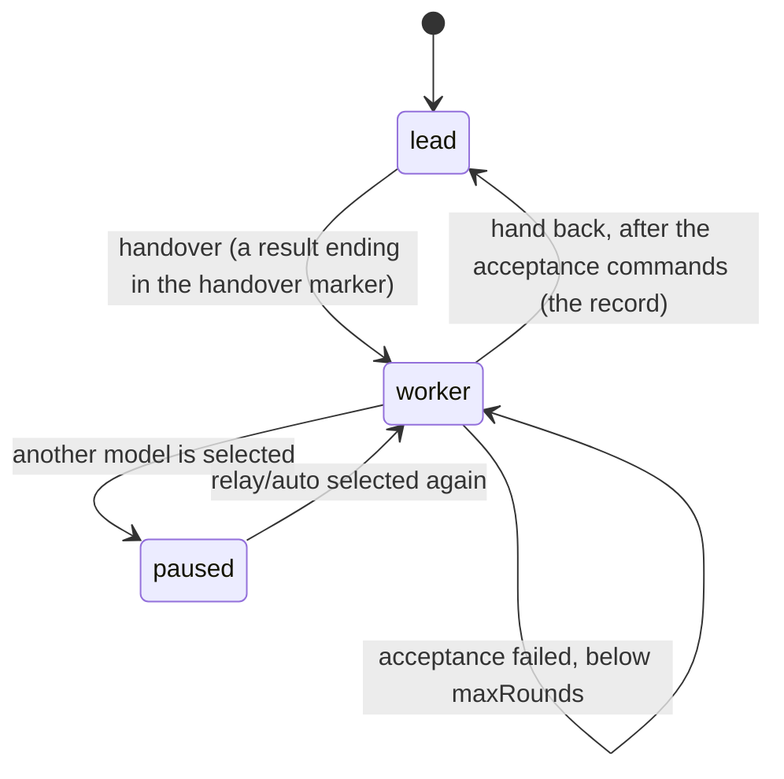

# Relay

Relay is a [virtual model](virtual-models.md), `relay/auto`, that runs one conversation on two models. A strong model,
the **lead**, explores, decides the plan and reviews the result. A cheap model, the **worker**, carries the plan out.
The lead's tokens go to judgement; file reads, test output and mechanical edits go to the worker.

```
xpi --model relay/auto
```

or `/model relay/auto` in a session. The footer shows which model answers. The built-in `relay` extension provides it;
`-builtin:relay` in `extensions` turns it off.

Relay is for transparency, observability and saving money. Both models work in one session, so the work of both stays
on record: the hand-back compaction changes only what the lead's later requests read, and the worker's steps stay in the
session file, in the scrollback and in `/tree`. Every phase change and every repair of a mistake is an entry on the
branch and a line on screen (see [Repairs and what you see](#repairs-and-what-you-see)). Orchestrating several agents is
the job of [workflows](subagent.md#workflows), not of relay: there is one worker at a time.

## How a task runs

```
lead explores → tools.handover({ plan, acceptance, findings })  (from a codemode script)
             → worker builds
             → acceptance commands run; on failure their output goes back to the worker
             → the conversation is compacted to a hand-back record
             → lead reads the record → answers / fixes a small thing / hands over again
```

1. **The lead explores and plans.** It reads what the decision depends on. Whether to hand over at all is its
   decision (see [What the lead is told](#what-the-lead-is-told)); when it does the work itself, nothing below happens.
2. **Handover.** The lead calls `tools.handover({...})` from a [codemode](codemode.md) script. The call ends the
   script and the lead's turn. From the next request on the worker answers. It reads the whole conversation, once and
   uncached, so nothing is lost in a brief.
3. **The worker builds** and calls `tools.handback({...})` from a script with a report, or simply stops.
4. **Acceptance.** xpi runs the handover's acceptance commands in the session's directory. If one fails, the output goes
   back to the worker and it continues, at most `maxRounds` times. A worker that hands back `blocked` skips this step.
5. **Hand back.** The conversation is compacted to the hand-back record, and the lead is asked to review. Nothing of the
   worker's transcript (the files it read, its failed attempts, its test runs) reaches the lead.



A user message during a worker phase goes to the worker: you are talking to the model that is doing the work. Use
`/handback` to reach the lead.

## What each role is told

While `relay/auto` is selected, every request carries a section named `relay` in the leading system message. It is
built from the router state stored on the session branch, so retries, `/tree` jumps and an ordinary compaction in a
worker phase all give the right role, and it is the same text for every request of a role in a round, so each model's
cached prefix stays stable. When another model is selected the section is removed.

- **The lead's section**: one line (`You are the lead in relay mode; the worker is <model>. To give the work away call
  tools.handover({...}) from codemode.`), `handover`'s fields, and the decision facts below. It names no way to call
  `handback`.
- **The worker's section**: one line (`You are the worker in relay mode. When done or stuck, call tools.handback({...})
  from codemode.`), `handback`'s fields, the handover as the lead wrote it (plan, criteria, findings, when to stop, the
  acceptance commands), and its duties. The plan is here, not only in the lead's script, so a compaction cannot
  summarize it away. It names no way to call `handover`, and no message is inserted into the conversation at a handover
  to tell the worker its role.

## What the lead is told

No rule says when to hand over. The lead's section gives it what a decision needs, and the decision is the lead's:

- **The objective**: `relay.objective`. By default, a correct result for as few lead tokens as possible, with worker
  tokens not counted.
- **The prices**: the API list prices of both models per million tokens (input, cached input, cache write, output,
  and the higher tier of a model that has one), and how many times a lead token costs a worker token. They are read
  from the model catalog, so they follow the models you configure. For example, with Opus 5.5 as lead and Haiku 5.5 as
  worker: input $4 against $0.1, output $20 against $0.5, 40 times each. With a pair of models whose prices are not
  known, it says so.
- **Time**: what a round adds (the worker's first read of the conversation, its work, the acceptance commands, the
  lead's reading of the record). Time is part of the objective only when `relay.minuteCost` is set: the lead is then
  told what one minute of your waiting is worth in dollars of tokens, and can weigh it against the prices.
- **What a handover does**: the worker reads the whole conversation and works until it hands back or stops; the
  acceptance commands are run, and a failure goes back to the worker at most `maxRounds` times.
- **What comes back**: what the record keeps as written, what is new in it, and what is not kept (the worker's steps,
  and the tool output the lead read before the handover).
- **That nothing is final** after a hand back: the lead can read, change things itself, or hand over again.
- **About the worker**: `relay.workerRecord`, when set. For example a measured result of the worker model on tasks
  of this project.

After each hand back the lead is also told what was measured: how long the round took from the handover to the hand
back, how much of that the acceptance commands took, and what each model has used in the session so far (requests,
tokens by kind, cost, time in requests and output tokens per second). So from the second decision on, the lead
knows the cost and the speed of a round in this very session.

A stronger model needs no more than this; a setup where the lead decides badly is corrected by changing these facts,
not by adding rules. `npm run eval:delegation` measures the decisions (see [Limits](#limits)).

## The two tools

Both are `deferred`, [unlisted](codemode.md#unlisted-tools) tools: they are not declared to either model and are in no
codemode listing, `ALL_TOOLS` or `searchTools()`. A script calls them by name (`await tools.handover({...})`), and each
role learns only its own tool from its prompt. They refuse to run unless `relay/auto` is selected. Both end the turn:
the script stops at the call and the loop stops after the response; other tool calls of the same response finish. The
result of `handover` is its marker line `<relay-handover round="N"/>` and nothing else; because a codemode result ends
with the text of the call that ended the script, the marker is the last line of the result, and the router takes a
handover only from the last line of a `handover` or `codemode` result that names the next round (a file the worker
reads that contains the string does not count).

**With codemode off** (`-codemode`, or the tool not active) both roles see both tools, because they are ordinary
direct tools (the one-tool-per-role rule needs codemode); they are registered as `direct` tools and the
prompt says `call handover({...})`. Exposure is fixed at registration, so relay checks at `session_start`,
`model_select` and `before_agent_start` and registers the tools again only when codemode's state changed. `/relay` says
`codemode is off: the hand tools are direct tools`.

**`handover`** (lead)

| Field | Meaning |
|---|---|
| `plan` | The steps, in order, specific enough to follow without the lead. |
| `acceptance` | Shell commands that must exit 0 when the work is done (tests, a type check, a grep). Optional. |
| `criteria` | What done means beyond the commands. The lead reviews the result against it. |
| `findings` | What the lead learned and must not lose: the files involved, constraints, traps. |
| `stopWhen` | When the worker must stop and hand back instead of pushing on. |

**`handback`** (worker): `status` (`done` or `blocked`) and `report`. A worker run that ends without the call counts as
done, with its last message as the report.

Two calls in one response make one hand-off. A second `handover` in the same script never runs, because the first ends
the script. In a second parallel codemode call it answers `Already handed over.` (or `Already handed back.`), which is no
error and no mix-up.

The acceptance commands are written by the model and run without asking, like the model's own `bash` calls.

## The hand-back record

The record replaces the conversation. It holds, in this order:

- the summary of an earlier ordinary compaction, if there was one;
- the user's messages and the lead's replies, as written, without tool activity (when they exceed 40,000 characters,
  the oldest lead replies are dropped first; the user's messages stay);
- one line per earlier round;
- the lead's handover note, word for word;
- the worker's report;
- one line for each repair of the round (a corrected call, a continuation, a direct call), so the lead knows when the
  worker needed help;
- the changes since the handover: `git diff --stat`, files git does not track, and the diff up to `diffChars`
  characters (beyond that the lead is told how to read the rest). Outside a git repository this part is empty;
- each acceptance command with its exit status and the end of its output.

The lead's own judgement is kept in its own words; the worker summarizes only its own work; the rest is output of
commands.

## The transition table

One pure function, `transition(view, event, config)` in `extensions/relay/machine.ts`, decides every phase change; the
code in `index.ts` reads the session into a view, calls it, and carries out the effects it returns (a tool result, an
entry, the acceptance commands, the compaction, a continuation, a notification). The view is the router state stored on
the branch plus what relay's entries add: wrong-role calls and continuations so far in the round, a pause, and a
pending hand-off (a `relay.handover` or `relay.handback` entry written after the latest router-state, `relay.transition`
or `relay.verify` entry: the stored state changes only at the next request). Where two rows match, the earlier wins;
every other pair changes nothing and answers with a refusal.

| View | Event | Next | Effects |
|---|---|---|---|
| any with a pending hand-off | handover / handback | unchanged | result "Already handed over/back." (no error, not counted) |
| lead | handover | pending worker, round + 1 | `relay.handover` entry; the marker as the result; the turn ends |
| worker | handback | pending hand back | `relay.handback` entry; "Handed back."; the turn ends |
| worker | wrong role (handover), first time | mixups 1 | `relay.mixup`; an error with the correction |
| worker | wrong role (handover), second time | pending hand back, blocked | `relay.mixup` and a blocked `relay.handback` ("The worker mixed up its role twice"); the turn ends |
| lead | wrong role (handback) | mixups + 1 | `relay.mixup`; an error with the correction (the lead is never handed back for) |
| worker | run ends with a pending hand back | acceptance | acceptance commands, unless blocked or the user asked (`/handback`) |
| worker | run ends after a relay error, stalls < 2 | stalls + 1 | `relay.stall`; continue with a role reminder |
| worker | run ends after a relay error, stalls = 2 | hand back, blocked | a blocked hand back ("The worker stopped after relay errors") and the record |
| lead | run ends after a relay error, stalls < 2 | stalls + 1 | `relay.stall`; continue with a role reminder |
| lead | run ends after a relay error, stalls = 2 | unchanged | the run ends; you see it |
| worker | run ends (otherwise) | acceptance | acceptance commands, unless the user asked |
| worker | acceptance failed, failures so far < `maxRounds` | unchanged | `relay.verify`; continue with the failure output |
| worker | acceptance passed, failed at `maxRounds`, or nothing to run | lead, mixups 0, stalls 0 | compact to the record; `relay.transition` |
| worker | another model selected | paused | `relay.pause`; notification |
| paused | `relay/auto` selected | worker | `relay.resume`; notification |
| lead | another model selected / `relay/auto` selected | unchanged | none |

Notes: a handover resets mixups and stalls. Whether a run "ends after a relay error" is read from the `relay.mixup`
entry (inside a script the error is a nested result): only a wrong-role call counts, so a lead that stops after another
relay error, such as an empty plan, is not continued: that is its call. One row is not in the lead's request path:
after a `handover` ends the lead's turn, the run ends with a pending handover and relay continues it, so the worker
answers next. Relay continues it only when a tool result really ends with the marker of the next round; a handover whose call
was cut off (an unawaited call, Esc) is voided with a `relay.void` entry and a line, and the lead goes on. `/handback` sets a flag and asks the worker to report; the worker's own `handback` in the same phase
supplies the report, and the flag skips the acceptance commands, so racing the two is one hand back.

## Repairs and what you see

A mistake of a model is repaired by a hook, without a request of the strong model where possible, and nothing a hook
repairs or decides is silent. None of it enters a model's context as a message: transitions and repairs are `custom`
entries on the branch (they cost no tokens and do not touch the cached prefix) and `ui.notify` lines. In print mode the
lines go to stderr with `--verbose`.

- **A phase change**: a `relay.transition` entry (`from`, `to`, `event`, `round`, `at`) and one line, for example
  `relay: lead → worker (round 2)`.
- **A direct call** of `handover` or `handback` while codemode is on is run as a codemode call by the agent loop, with a
  note on the first line of its result (see [Codemode](codemode.md#a-direct-call-of-a-tool-only-scripts-can-reach)): a
  `relay.direct` entry and `relay: direct handover(...) run as a codemode call`. The result still ends with the marker,
  so the handover counts.
- **A wrong-role call** (the worker calls `handover`, the lead calls `handback`): a `relay.mixup` entry and
  `relay: worker called handover, corrected (1 of 2)`. The error names the caller's own tool. The worker's second one
  hands back as `blocked`: `relay: roles mixed up twice, handed back as blocked`.
- **A stop after such an error**: continued with a short role reminder, at most twice: a `relay.stall` entry and
  `relay: worker stopped after an error, continued (1 of 2)`. The correction or reminder goes to the model that erred.
- **A pause**: `relay paused (worker phase, round N)` and `relay resumed (worker phase, round N)`.

`/relay` shows who has the work and the two models, this round's transitions and repairs with their ages, and what each
model has used in the session (the numbers the lead gets after a hand back). The hand-back record lists the round's
repairs, once.

## Switching models

`/model` to another model in a worker phase pauses the relay: a `relay.pause` entry and a notification. The other
model sees neither relay text nor the tools (they refuse to run). Selecting `relay/auto` again writes `relay.resume`
and the worker answers the next request.

## What the lead pays for

| Step | Lead tokens |
|---|---|
| Exploring and planning | Its own reading and thinking. Wide searches can go to cheap scouts with the [`Agent`](subagent.md) tool. |
| `handover` | The note it writes. |
| Worker phase, acceptance rounds | None. |
| Hand back | The system prompt and tools from the prompt cache while it lasts (5 minutes by default), plus a cache write of the record. |

After a hand back every later lead request reads the record, not the conversation it replaced.

### Measured

`npm run eval:delegation -- --long`, 2026-11-10, Opus 5.5 as lead and Haiku 5.5 as worker, on six features of this
repository built again from their spec (about 1,200 changed lines over 20 files in the original unless noted; done
when the offline subagent suite passes). One run per cell, so differences of 10 to 20 percent mean nothing.

| Task | Way of working | Passed | Time | Opus cost | Haiku cost | Handovers |
|---|---|---|---|---|---|---|
| fork agent type | Opus alone | yes | 365 s | $1.52 | | |
| | Haiku alone | yes | 676 s | | $0.71 | |
| | relay, the lead decides | yes | 472 s | $0.21 | $0.26 | 1 |
| | relay, told to hand over | yes | 624 s | $0.18 | $0.10 | 1 |
| names and SendMessage | Opus alone | yes | 282 s | $0.93 | | |
| | Haiku alone | yes | 502 s | | $0.11 | |
| | relay, the lead decides | yes | 345 s | $0.19 | $0.06 | 1 |
| | relay, told to hand over | yes | 717 s | $0.24 | $0.04 | 1 |
| agent file fields | Opus alone | yes | 332 s | $1.15 | | |
| | Haiku alone | yes | 540 s | | $0.18 | |
| | relay, the lead decides | yes | 526 s | $0.24 | $0.33 | 1 |
| | relay, told to hand over | yes | 778 s | $0.22 | $0.15 | 2 |
| saved workflows (2,600 lines) | Opus alone | yes | 845 s | $3.70 | | |
| | Haiku alone (2 runs) | yes | 1,118 s | | $1.63 | |
| | relay, the lead decides | yes | 833 s | $0.24 | $0.90 | 1 |
| relaunch and pause | Opus alone | yes | 700 s | $2.74 | | |
| | Haiku alone (2 runs) | yes | 880 s | | $1.04 | |
| | relay, the lead decides | yes | 1,000 s | $0.24 | $0.96 | 1 |
| structured output (1,600 lines) | Opus alone | yes | 293 s | $1.02 | | |
| | Haiku alone (2 runs) | yes | 322 s | | $0.13 | |
| | relay, the lead decides | yes | 447 s | $0.21 | $0.23 | 1 |

- With the facts above and no rule, the lead handed over in all six tasks, after 2 to 8 requests of its own. Its
  cost stayed between $0.19 and $0.24 whatever the size of the task: 6 to 21 percent of what it spent alone.
- The time was longer than Opus alone in five of six tasks. It was shorter than Haiku alone in four and longer, by
  about two minutes, in two: a round is the lead's exploring, the worker's work and the lead's review, and the
  worker's part alone takes about what the worker needs without a lead.
- With the earlier prompt, which told the lead when to hand over but gave it neither prices nor an objective, the lead
  never handed over in the first three tasks: relay cost the same as Opus alone.
- Haiku alone passes all six tasks. They show what a handover costs and saves, not what the lead's judgement is
  worth on a task the worker cannot do by itself. Against Haiku alone, relay buys the lead's plan and review for
  about twenty cents; against Opus alone, it saves most of the lead's cost for more time.
- Haiku's cost on the larger tasks is far from one fortieth of Opus's: it makes many more requests, and its price is
  five times higher above 100,000 prompt tokens.
- In the same evaluation neither model started a subagent with the `Agent` tool on its own, in ten small tasks and
  six long ones, with or without prices and an objective in the tool's description. The small tasks meant for
  delegation (a search over 40 files, a 3,000-line log) were done with one codemode script for a few cents.

## Commands

| Command | Description |
|---|---|
| `/handover [instructions]` | Give the work to the worker now, without a plan from the lead. |
| `/handback` | Wake the lead now: the worker is told to stop and report, and the acceptance commands are not run. |
| `/relay` | Show who has the work, the round, the two models, this round's transitions and repairs, and the spend of each model. |

## Settings

```json
{
  "relay": {
    "lead": "anthropic/claude-opus-5-5",
    "worker": "anthropic/claude-haiku-5-5",
    "leadThinking": { "plan": "high", "review": "medium" },
    "workerThinking": "medium",
    "maxRounds": 3,
    "acceptanceTimeoutMs": 600000,
    "diffChars": 20000,
    "objective": "the user wants a correct result for as few of your (lead) tokens as possible. Worker tokens are not counted."
  }
}
```

| Key | Default | Meaning |
|---|---|---|
| `lead` | `anthropic/claude-opus-5-5` | The model that explores, plans and reviews, as `provider/model`. |
| `worker` | `anthropic/claude-haiku-5-5` | The model that builds. It also writes the summary of an ordinary compaction. |
| `leadThinking.plan` | `high` | The lead's thinking level before the first handover. |
| `leadThinking.review` | `medium` | The lead's thinking level after a hand back. |
| `workerThinking` | `medium` | The worker's thinking level. |
| `maxRounds` | `3` | Times failed acceptance commands go back to the worker before the lead is woken regardless. `0`: never. |
| `acceptanceTimeoutMs` | `600000` | Time limit of one acceptance command. |
| `diffChars` | `20000` | How much of the diff goes into the record. `0`: the stat only. |
| `objective` | see above | What the user optimizes for, told to the lead. Change it to weigh time, or to count worker tokens. |
| `workerRecord` | unset | What is known about the worker's ability, told to the lead. |
| `minuteCost` | unset | What one minute of your waiting is worth, in dollars of tokens. Unset: time is not part of the objective. |

The values are read at each request, so a change applies to the next one. A wrong value ends the request with an
error that names the key. The thinking level selected for `relay/auto` itself is not used.

## Limits

- One worker at a time. The lead can start parallel agents with the `Agent` tool.
- The phase is router state on the session branch: a fork or a `/tree` jump sees the phase of its own branch.
- Esc during a worker phase leaves the work with the worker. The next message goes to it; `/handback` wakes the lead. A
  handover whose response was cut short (Esc, an error before its result was written) leaves the phase as it was.
- A worker run that ends in a provider error is not handed back. Send a message to let the worker continue.
- Subagents do not get the relay model or its tools.
- Tests: `test/relay-machine.test.ts` (every row of the table), `test/suite/relay.test.ts` (faux provider), `npm run test:relay:real` (real models; both roles are Haiku
  unless `RELAY_TEST_LEAD` names another model).
- `npm run eval:delegation -- --long` runs long tasks (features of this repository built again from their spec) three
  ways: the main model alone, with the `Agent` tool, and as the lead of `relay/auto`. It reports the result, each
  model's tokens and cost, and how often the model delegated or handed over. `EVAL_MAIN` names the main model
  (default Haiku); `--force` tells the model to delegate, for comparison with its own decision. Two multi-agent
  tasks run through `xpi --mode rpc`, where scripts can run in the background, and also report how main waited for
  its agents (see [Subagents: Waiting for agents](subagent.md#waiting-for-agents)); `--cli <path>` runs another build.
  A failing run keeps its directory (repository and sessions); `EVAL_KEEP=1` keeps those of passing runs too.

## Porting

The relay is one entry of [Porting xpi features](porting.md#relay): what it needs from the host (a virtual model, the
`agent_before_settle` boundary with a compaction draft, codemode with nested `terminate`, unlisted tools and the
direct-call repair of the agent loop), what to copy and rename, and how to verify it.
